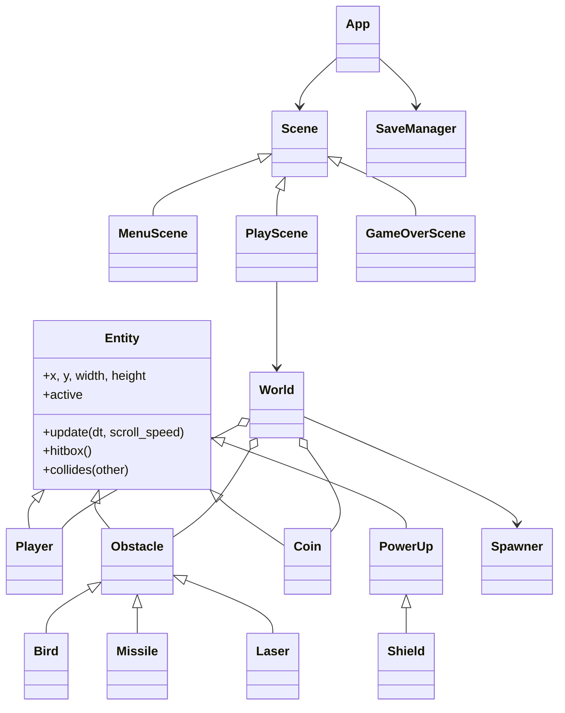

# Comment utiliser ce guide

Ce guide accompagne le GitHub Project. **Avant de commencer une tâche, lis sa section ici.** Chaque tâche indique l'objectif, les fichiers à toucher, les étapes, un exemple de code et le moment où elle est terminée.

Les exemples de code sont un **point de départ** : lis-les, comprends chaque ligne, puis adapte-les. Si une ligne n'est pas claire, demande à l'équipe avant de copier.

## Le vocabulaire en 1 minute

| Mot | Ce que ça veut dire chez nous |
|---|---|
| **User story (US)** | Un besoin vu par le joueur : « En tant que joueur, je veux… afin de… ». C'est une issue GitHub avec le label `user story`. |
| **Critères d'acceptation** | La liste de ce qui doit marcher pour dire que la story est finie. |
| **Tâche (T)** | Un petit morceau de travail technique pour réaliser une story. C'est une **sous-issue** de la story. Une tâche = une personne = une branche. |
| **Sprint** | Une période de 2 à 3 semaines. Sur GitHub, chaque sprint est un **milestone** (Sprint 1, 2, 3). |
| **Taille** | S = moins d'une période, M = 1 à 2 périodes, L = 3 périodes ou plus. |
| **PR (pull request)** | La demande pour fusionner ta branche dans `main`. Quelqu'un d'autre la relit avant. |

## Le tableau GitHub Project

Colonnes conseillées : **Todo → In Progress → In Review → Done**.

1. Au début du sprint, filtre le Project sur le milestone du sprint (`milestone:"Sprint 1"`).
2. Prends une tâche : assigne-la-toi et déplace-la dans **In Progress**.
3. Quand ta PR est ouverte : **In Review**.
4. Quand la PR est fusionnée avec `Closes #numéro` : l'issue se ferme et passe en **Done**.
5. Une story est finie quand toutes ses sous-issues sont fermées **et** que ses critères d'acceptation sont vrais. C'est le SM qui la ferme.

## Les branches Git

```text
main      ●───────────────●───────────────●──────────  (fin des sprints 1, 2, 3)
           \             ↗ PR Sprint 1   ↗ PR Sprint 2
develop     ●──●──●──●──●──●──●──●──●──●──
               ↑     ↑        ↑
feature/T08-entity   feature/T09-gravite-poussee   ...
```

| Branche | Rôle | Qui écrit dessus |
|---|---|---|
| `main` | Version stable, rendue à la fin de chaque sprint | Personne directement : une seule PR `develop → main` par sprint |
| `develop` | Le code du sprint en cours, toujours lançable | Personne directement : uniquement des PR de tâches |
| `feature/…`, `test/…`, `docs/…`, `chore/…` | Une tâche = une branche, créée depuis `develop` | La personne assignée à la tâche |
| `fix/<numéro>-<description>` | Correction d'un bug signalé dans une issue | Celui qui corrige |

**Pourquoi une branche par tâche et pas par user story ?** Une story est partagée entre plusieurs personnes (US03 a 5 tâches). Une branche de story deviendrait une deuxième `develop`, avec plus de fusions et plus de conflits. Les sous-issues regroupent déjà les tâches par story dans GitHub.

**Règle de nommage :** `type/Tnn-description-courte` en minuscules, sans accents ni espaces. Le type dit ce que fait la branche : `feature` (fonctionnalité), `test` (tests), `docs` (documentation), `chore` (configuration).

### Quand faire une pull request ?

| PR | Quand ? | Qui l'ouvre ? | Qui fusionne ? |
|---|---|---|---|
| `feature/…` → `develop` | **À la fin de chaque tâche**, dès que ses cases « C'est terminé quand » sont cochées. Une tâche = une PR. | La personne qui a fait la tâche | Un **autre** membre, après relecture |
| `develop` → `main` | **Une seule fois par sprint**, le dernier jour, après la démo du sprint | Le SM (Tavee) | Le SM, avec l'accord de l'équipe |
| `fix/…` → `develop` | Dès qu'un bug signalé dans une issue est corrigé | Celui qui corrige | Un autre membre |

**Avant d'ouvrir une PR vers `develop`, vérifie ces 4 points :**

1. Ta tâche est finie : toutes ses cases « C'est terminé quand » sont cochées.
2. Ta branche contient le dernier `develop` (commandes ci-dessous), pour régler les conflits chez toi et pas dans la PR.
3. `python -m pytest` passe et `python main.py` lance le jeu.
4. La PR vise bien **`develop`** (pas `main`) et sa description contient `Closes #numéro` de l'issue de la tâche.

```shell
git switch develop
git pull
git switch feature/T09-gravite-poussee
git merge develop
python -m pytest
git push
```

**N'attends pas d'avoir fini toute la story** pour ouvrir une PR. Les petites PR sont relues plus vite et créent moins de conflits. Si une tâche dure plus de 2 périodes, découpe-la ou ouvre une PR en brouillon (*Draft*) pour montrer où tu en es.

**Le relecteur** lit le code, récupère la branche, lance les tests et le jeu, puis approuve ou laisse des commentaires. Visez une relecture dans la journée.

**Une user story est terminée** quand toutes les PR de ses tâches sont fusionnées dans `develop` et que ses critères d'acceptation sont vrais. Elle arrive sur `main` avec la PR de fin de sprint.

**On ne fait jamais de PR vers `main` en cours de sprint**, sauf accord de toute l'équipe pour un bug bloquant avant une démo.

### Fin de sprint : fusionner `develop` dans `main`

1. Le dernier jour du sprint, toutes les PR du sprint sont fusionnées dans `develop`. Les tâches pas finies sont déplacées vers le milestone du sprint suivant. `python -m pytest` passe sur `develop`.
2. Le SM ouvre une PR `develop → main` intitulée « Sprint 1 — Le capybara vole ».
3. Toute l'équipe lance le jeu depuis `develop` une dernière fois, puis on fusionne.
4. On marque la version et on ferme le milestone :

```shell
git switch main
git pull
git tag sprint-1
git push origin sprint-1
```

### Fermer les issues automatiquement

GitHub ne ferme une issue avec `Closes #29` que si la PR vise **la branche par défaut** du dépôt. Comme vos PR de tâches visent `develop`, Eyuel (propriétaire du dépôt) doit mettre `develop` comme branche par défaut : **Settings → General → Default branch**. Sinon, il faut fermer chaque issue à la main après la fusion.

### Toutes les branches

| Tâche | Branche | Titre |
|---|---|---|
| T01 | `chore/T01-installation-env` | Installer Python 3.13, pygame et pytest |
| T02 | `chore/T02-structure-projet` | Créer la structure des dossiers du projet |
| T03 | `docs/T03-regles-git` | Écrire les règles Git de l'équipe |
| T04 | `test/T04-config-pytest` | Configurer pytest et les tests (sans GitHub Actions) |
| T05 | `feature/T05-config` | Créer le fichier de configuration |
| T06 | `feature/T06-boucle-principale` | Écrire la boucle principale du jeu |
| T07 | `feature/T07-scenes` | Créer le système de scènes |
| T08 | `feature/T08-entity` | Créer la classe de base Entity |
| T09 | `feature/T09-gravite-poussee` | Coder la gravité et la poussée du joueur |
| T10 | `feature/T10-limites-ecran` | Garder le capybara dans l'écran |
| T11 | `test/T11-tests-player` | Tester la classe Player |
| T12 | `feature/T12-play-scene` | Brancher le joueur dans la scène de jeu |
| T13 | `feature/T13-world` | Créer la classe World (l'état d'une partie) |
| T14 | `feature/T14-fond-defilant` | Faire défiler le fond en boucle |
| T15 | `feature/T15-collision-aabb` | Coder la détection de collision (AABB) |
| T16 | `feature/T16-oiseau-missile` | Créer les obstacles Oiseau et Missile |
| T17 | `feature/T17-spawner` | Générer les obstacles au hasard |
| T18 | `feature/T18-game-over-collision` | Terminer la partie en cas de collision |
| T19 | `feature/T19-menu` | Créer le menu principal |
| T20 | `feature/T20-ecran-game-over` | Créer l'écran de fin de partie |
| T21 | `feature/T21-intro-lore` | Créer l'intro qui raconte l'histoire |
| T22 | `feature/T22-pieces` | Créer les pièces et leurs motifs |
| T23 | `feature/T23-ramassage-pieces` | Ramasser les pièces et les compter |
| T24 | `feature/T24-score-metres` | Calculer le score en mètres |
| T25 | `feature/T25-hud` | Afficher le HUD (score et pièces) |
| T26 | `feature/T26-sauvegarde-json` | Sauvegarder le meilleur score en JSON |
| T27 | `feature/T27-meilleur-score` | Afficher et mettre à jour le meilleur score |
| T28 | `feature/T28-autres-obstacles` | Créer les 4 autres obstacles |
| T29 | `feature/T29-difficulte` | Augmenter la difficulté progressivement |
| T30 | `feature/T30-graphismes` | Remplacer les rectangles par les vrais graphismes |
| T31 | `feature/T31-powerups-bouclier` | Créer les objets à effet et le bouclier |
| T32 | `feature/T32-x2-aimant` | Ajouter Pièces x2 et Aimant |
| T33 | `test/T33-tests-powerups` | Tester les objets à effet |
| T34 | `feature/T34-decor-evolutif` | Faire évoluer le décor : Terre → ciel → univers |
| T35 | `feature/T35-trainee-arc-en-ciel` | Dessiner la traînée arc-en-ciel |
| T36 | `feature/T36-audio` | Ajouter la musique et les effets sonores |
| T37 | `docs/T37-diagramme-classes` | Dessiner le diagramme de classes |
| T38 | `test/T38-tests-manuels` | Passer la checklist de tests manuels et corriger les bugs |
| T39 | `docs/T39-rapport` | Rédiger le rapport de fin (3 à 4 pages) |
| T40 | `docs/T40-presentation` | Préparer la présentation finale et la démo |
| T41 | `feature/T41-boost` | \[Bonus\] Créer l'objet Boost |
| T42 | `feature/T42-objets-speciaux` | \[Bonus\] Créer les objets spéciaux |
| T43 | `feature/T43-boss` | \[Bonus\] Créer un boss |
| T44 | `feature/T44-boutique-skins` | \[Bonus\] Créer la boutique de skins |

## L'architecture en une image

```text
         clavier / souris
               │
               ▼
   ┌───────────────────────┐        ┌─────────────────────────┐
   │  ui/  (pygame)        │ lit    │  logic/  (pas de pygame) │
   │  App → Scene actuelle │ ─────► │  World                   │
   │  dessine, joue le son │ ◄───── │   ├ Player               │
   └───────────────────────┘ état   │   ├ Obstacles, Coins     │
               │                    │   ├ Spawner (hasard)     │
               ▼                    │   └ effects, events      │
            écran                   │  SaveManager → save.json │
                                    └─────────────────────────┘
```

**La règle d'or :** les fichiers de `capycalypse/logic/` n'importent **jamais** pygame. Ils contiennent les règles du jeu (physique, collisions, score). `capycalypse/ui/` lit l'état du `World` et le dessine. Ce découpage :

- répond aux consignes (« séparer la logique du jeu de l'interface graphique ») ;
- permet de tester la logique avec pytest, sans ouvrir de fenêtre ;
- évite que 4 personnes modifient le même fichier en même temps.

Chaque image du jeu (60 fois par seconde) se passe ainsi : la scène lit le clavier → `world.update(dt)` fait avancer le jeu → la scène dessine le `World` → la scène lit `world.events` pour jouer les sons.

## Les tests (sans GitHub Actions)

**Ce qu'on teste avec pytest :** tout ce qui est dans `logic/` (physique, collisions, score, sauvegarde, effets). Les tests sont dans `tests/` et leurs noms commencent par `test_`.

**Ce qu'on teste à la main :** l'affichage, les menus et le son, avec la checklist de T38.

**La règle d'équipe, qui remplace GitHub Actions :**

1. Avant d'ouvrir une PR vers `develop`, tu lances `python -m pytest`. Tout doit être vert.
2. Le relecteur récupère la branche et relance les tests avant d'approuver.
3. Le modèle de PR (T03) contient une case à cocher pour ça.

```shell
git fetch
git switch feature/T09-gravite-poussee
python -m pytest
```

**À propos de GitHub Actions :** ne pas être le créateur du dépôt ne bloque pas forcément. Toute personne avec un accès en écriture peut ajouter un fichier `.github/workflows/tests.yml`. Si Eyuel vous a ajoutés comme collaborateurs, essayez : créez le fichier via le bouton **Add file** sur GitHub (pousser un workflow en ligne de commande demande un jeton avec le droit `workflow`). Si les tests se lancent dans l'onglet **Actions**, c'est gagné ; sinon, la règle ci-dessus suffit.

```yaml
# .github/workflows/tests.yml
name: Tests
on:
  push:
    branches: [develop, main]
  pull_request:
    branches: [develop, main]
jobs:
  test:
    runs-on: ubuntu-latest
    steps:
      - uses: actions/checkout@v4
      - uses: actions/setup-python@v5
        with:
          python-version: "3.13"
      - run: pip install -r requirements.txt
      - run: python -m pytest
```

## « Terminé », pour toutes les tâches

Une tâche est terminée seulement si :

- [ ] le code est sur `develop` via une PR relue par une autre personne ;
- [ ] `python -m pytest` passe ;
- [ ] le jeu se lance encore avec `python main.py` ;
- [ ] aucun `import pygame` dans `logic/` ;
- [ ] les critères « C'est terminé quand » de la tâche sont cochés.

## Proposition de répartition

Chaque personne garde un **domaine** d'un sprint à l'autre, pour bien connaître son code et éviter les conflits. Ce n'est qu'une proposition : changez-la au sprint planning.

| Membre | Domaine | Sprint 1 | Sprint 2 | Sprint 3 |
|---|---|---|---|---|
| Tavee (SM) | Organisation, qualité, données | T02–T05 | T21, T26, T27, T30 | T37, coordination de T39–T40 |
| Eyuel | Joueur, pièces, objets | T08–T12 | T22–T24 | T31–T33 |
| Ruben | Boucle, scènes, monde, décor | T06, T07, T13, T14 | T19, T20, T25 | T34, T35 |
| Arthur | Obstacles, difficulté, son | T15–T18 | T28, T29 | T36 |

**Ordre de démarrage du sprint 1 :** T01 (tout le monde) → T02 et T05 (Tavee) → T06 (Ruben) et T08 (Eyuel) en premier, car les autres tâches en dépendent.

# Vue d'ensemble du backlog

**Sprint 1 — Le capybara vole**

| Tâche | Titre | Branche | Story | Taille | Proposé à |
|---|---|---|---|---|---|
| T01 | Installer Python 3.13, pygame et pytest | `chore/T01-installation-env` | US01 | S | Tout le monde |
| T02 | Créer la structure des dossiers du projet | `chore/T02-structure-projet` | US01 | S | Tavee |
| T03 | Écrire les règles Git de l'équipe | `docs/T03-regles-git` | US01 | S | Tavee |
| T04 | Configurer pytest et les tests (sans GitHub Actions) | `test/T04-config-pytest` | US01 | S | Tavee |
| T05 | Créer le fichier de configuration | `feature/T05-config` | US02 | S | Tavee |
| T06 | Écrire la boucle principale du jeu | `feature/T06-boucle-principale` | US02 | M | Ruben |
| T07 | Créer le système de scènes | `feature/T07-scenes` | US02 | M | Ruben |
| T08 | Créer la classe de base Entity | `feature/T08-entity` | US03 | S | Eyuel |
| T09 | Coder la gravité et la poussée du joueur | `feature/T09-gravite-poussee` | US03 | M | Eyuel |
| T10 | Garder le capybara dans l'écran | `feature/T10-limites-ecran` | US03 | S | Eyuel |
| T11 | Tester la classe Player | `test/T11-tests-player` | US03 | S | Eyuel |
| T12 | Brancher le joueur dans la scène de jeu | `feature/T12-play-scene` | US03 | M | Eyuel |
| T13 | Créer la classe World (l'état d'une partie) | `feature/T13-world` | US04 | M | Ruben |
| T14 | Faire défiler le fond en boucle | `feature/T14-fond-defilant` | US04 | M | Ruben |
| T15 | Coder la détection de collision (AABB) | `feature/T15-collision-aabb` | US05 | S | Arthur |
| T16 | Créer les obstacles Oiseau et Missile | `feature/T16-oiseau-missile` | US05 | M | Arthur |
| T17 | Générer les obstacles au hasard | `feature/T17-spawner` | US05 | M | Arthur |
| T18 | Terminer la partie en cas de collision | `feature/T18-game-over-collision` | US05 | S | Arthur |

**Sprint 2 — Un vrai jeu**

| Tâche | Titre | Branche | Story | Taille | Proposé à |
|---|---|---|---|---|---|
| T19 | Créer le menu principal | `feature/T19-menu` | US06 | M | Ruben |
| T20 | Créer l'écran de fin de partie | `feature/T20-ecran-game-over` | US06 | M | Ruben |
| T21 | Créer l'intro qui raconte l'histoire | `feature/T21-intro-lore` | US07 | M | Tavee |
| T22 | Créer les pièces et leurs motifs | `feature/T22-pieces` | US08 | M | Eyuel |
| T23 | Ramasser les pièces et les compter | `feature/T23-ramassage-pieces` | US08 | S | Eyuel |
| T24 | Calculer le score en mètres | `feature/T24-score-metres` | US09 | S | Eyuel |
| T25 | Afficher le HUD (score et pièces) | `feature/T25-hud` | US09 | S | Ruben |
| T26 | Sauvegarder le meilleur score en JSON | `feature/T26-sauvegarde-json` | US10 | M | Tavee |
| T27 | Afficher et mettre à jour le meilleur score | `feature/T27-meilleur-score` | US10 | S | Tavee |
| T28 | Créer les 4 autres obstacles | `feature/T28-autres-obstacles` | US11 | L | Arthur |
| T29 | Augmenter la difficulté progressivement | `feature/T29-difficulte` | US11 | M | Arthur |
| T30 | Remplacer les rectangles par les vrais graphismes | `feature/T30-graphismes` | US11 | M | Tavee |

**Sprint 3 — Ambiance et livraison**

| Tâche | Titre | Branche | Story | Taille | Proposé à |
|---|---|---|---|---|---|
| T31 | Créer les objets à effet et le bouclier | `feature/T31-powerups-bouclier` | US12 | M | Eyuel |
| T32 | Ajouter Pièces x2 et Aimant | `feature/T32-x2-aimant` | US12 | M | Eyuel |
| T33 | Tester les objets à effet | `test/T33-tests-powerups` | US12 | S | Eyuel |
| T34 | Faire évoluer le décor : Terre → ciel → univers | `feature/T34-decor-evolutif` | US13 | M | Ruben |
| T35 | Dessiner la traînée arc-en-ciel | `feature/T35-trainee-arc-en-ciel` | US14 | M | Ruben |
| T36 | Ajouter la musique et les effets sonores | `feature/T36-audio` | US15 | M | Arthur |
| T37 | Dessiner le diagramme de classes | `docs/T37-diagramme-classes` | US16 | M | Tavee |
| T38 | Passer la checklist de tests manuels et corriger les bugs | `test/T38-tests-manuels` | US16 | M | Tout le monde |
| T39 | Rédiger le rapport de fin (3 à 4 pages) | `docs/T39-rapport` | US16 | L | Tout le monde |
| T40 | Préparer la présentation finale et la démo | `docs/T40-presentation` | US16 | M | Tout le monde |

**Bonus (sans sprint, si le temps le permet)**

| Tâche | Titre | Branche | Story | Taille | Proposé à |
|---|---|---|---|---|---|
| T41 | \[Bonus\] Créer l'objet Boost | `feature/T41-boost` | US17 | S | À choisir |
| T42 | \[Bonus\] Créer les objets spéciaux | `feature/T42-objets-speciaux` | US18 | L | À choisir |
| T43 | \[Bonus\] Créer un boss | `feature/T43-boss` | US19 | L | À choisir |
| T44 | \[Bonus\] Créer la boutique de skins | `feature/T44-boutique-skins` | US20 | L | À choisir |

# Les dépendances : qui attend qui ?

Certaines tâches ont besoin du code d'une autre tâche pour commencer. Exemple : `Obstacle` **hérite** d'`Entity`, donc Arthur ne peut pas coder les obstacles (T16) avant qu'Eyuel ait poussé `Entity` (T08) sur `develop`.

**Comment lire cette partie :**

- **Vague 1** : peut commencer dès le premier jour du sprint.
- **Vague 2** : commence quand les tâches de la vague 1 dont elle dépend sont **fusionnées dans `develop`** (pas seulement finies sur ta branche).
- Dans les schémas, une flèche `A → B` veut dire « B attend A ». La couleur indique la personne.

**La règle qui évite d'attendre :** une tâche qui débloque d'autres personnes passe en priorité. Ouvre sa PR dès qu'elle est finie, et les relecteurs la relisent en premier.

## Sprint 1 — Le capybara vole


| Vague | Tâche | Qui | Attend | Débloque |
|---|---|---|---|---|
| 1 | T01 · Installer Python 3.13, pygame et pytest | Tout le monde | rien, commence tout de suite | — |
| 1 | T02 · Créer la structure des dossiers du projet | Tavee | rien, commence tout de suite | T04 (Tavee), T05 (Tavee), T06 (Ruben), T08 (Eyuel) |
| 1 | T03 · Écrire les règles Git de l'équipe | Tavee | rien, commence tout de suite | — |
| 2 | T05 · Créer le fichier de configuration | Tavee | T02 (Tavee) | T04 (Tavee), T06 (Ruben), T09 (Eyuel) |
| 2 | T08 · Créer la classe de base Entity | Eyuel | T02 (Tavee) | T09 (Eyuel), T15 (Arthur), T16 (Arthur) |
| 3 | T04 · Configurer pytest et les tests (sans GitHub Actions) | Tavee | T02 (Tavee), T05 (Tavee) | — |
| 3 | T06 · Écrire la boucle principale du jeu | Ruben | T02 (Tavee), T05 (Tavee) | T07 (Ruben) |
| 3 | T09 · Coder la gravité et la poussée du joueur | Eyuel | T05 (Tavee), T08 (Eyuel) | T10 (Eyuel), T12 (Eyuel), T13 (Ruben) |
| 3 | T15 · Coder la détection de collision (AABB) | Arthur | T08 (Eyuel) | T18 (Arthur) |
| 3 | T16 · Créer les obstacles Oiseau et Missile | Arthur | T08 (Eyuel) | T17 (Arthur) |
| 4 | T07 · Créer le système de scènes | Ruben | T06 (Ruben) | T12 (Eyuel) |
| 4 | T10 · Garder le capybara dans l'écran | Eyuel | T09 (Eyuel) | T11 (Eyuel) |
| 4 | T13 · Créer la classe World (l'état d'une partie) | Ruben | T09 (Eyuel) | T14 (Ruben), T17 (Arthur) |
| 5 | T11 · Tester la classe Player | Eyuel | T10 (Eyuel) | — |
| 5 | T12 · Brancher le joueur dans la scène de jeu | Eyuel | T07 (Ruben), T09 (Eyuel) | — |
| 5 | T14 · Faire défiler le fond en boucle | Ruben | T13 (Ruben) | — |
| 5 | T17 · Générer les obstacles au hasard | Arthur | T13 (Ruben), T16 (Arthur) | T18 (Arthur) |
| 6 | T18 · Terminer la partie en cas de collision | Arthur | T15 (Arthur), T17 (Arthur) | — |

### Que faire en attendant ?

- **Arthur** : En attendant `Entity` (T08, Eyuel, ~15 min) : écris déjà les 3 tests de T15 dans `tests/test_collision.py` (ils seront rouges, c'est normal), et lis la doc de `random.Random`. En attendant `World` (T13, Ruben) : finis T15 et T16, puis relis la PR de T08 ou T09.
- **Eyuel** : En attendant la structure (T02, Tavee) : fais T01 et lis la section T09 pour comprendre les 3 formules. T08 est la tâche qui débloque le plus de monde : fais-la en premier et ouvre la PR tout de suite.
- **Ruben** : En attendant `config.py` (T05, Tavee) : fais T01 et prépare `App` dans ta branche. En attendant `Player` (T09, Eyuel) pour T13 : avance T07 (scènes), puis relis les PR de T08 et T09.
- **Tavee** : T02 et T05 bloquent tout le monde : fais-les en premier (ce sont des tâches S), puis T03 et T04 pendant que les autres codent.

**Les tâches les plus bloquantes du sprint 1** (à faire et à relire en premier) :

- **T02** (Tavee) débloque 5 tâche(s) : T04, T05, T06, T08, T26
- **T05** (Tavee) débloque 3 tâche(s) : T04, T06, T09
- **T07** (Ruben) débloque 3 tâche(s) : T12, T19, T21
- **T08** (Eyuel) débloque 3 tâche(s) : T09, T15, T16
- **T09** (Eyuel) débloque 3 tâche(s) : T10, T12, T13

## Sprint 2 — Un vrai jeu


| Vague | Tâche | Qui | Attend | Débloque |
|---|---|---|---|---|
| 1 | T19 · Créer le menu principal | Ruben | T07 (Ruben) | T20 (Ruben) |
| 1 | T21 · Créer l'intro qui raconte l'histoire | Tavee | T07 (Ruben) | — |
| 1 | T22 · Créer les pièces et leurs motifs | Eyuel | T16 (Arthur), T17 (Arthur) | T23 (Eyuel) |
| 1 | T24 · Calculer le score en mètres | Eyuel | T13 (Ruben) | T25 (Ruben) |
| 1 | T26 · Sauvegarder le meilleur score en JSON | Tavee | T02 (Tavee) | T27 (Tavee) |
| 1 | T28 · Créer les 4 autres obstacles | Arthur | T16 (Arthur) | T29 (Arthur), T30 (Tavee) |
| 2 | T20 · Créer l'écran de fin de partie | Ruben | T18 (Arthur), T19 (Ruben) | T27 (Tavee) |
| 2 | T23 · Ramasser les pièces et les compter | Eyuel | T22 (Eyuel) | T25 (Ruben) |
| 2 | T29 · Augmenter la difficulté progressivement | Arthur | T17 (Arthur), T28 (Arthur) | — |
| 2 | T30 · Remplacer les rectangles par les vrais graphismes | Tavee | T28 (Arthur) | — |
| 3 | T25 · Afficher le HUD (score et pièces) | Ruben | T23 (Eyuel), T24 (Eyuel) | — |
| 3 | T27 · Afficher et mettre à jour le meilleur score | Tavee | T20 (Ruben), T26 (Tavee) | — |

## Sprint 3 — Ambiance et livraison


| Vague | Tâche | Qui | Attend | Débloque |
|---|---|---|---|---|
| 1 | T31 · Créer les objets à effet et le bouclier | Eyuel | T23 (Eyuel) | T32 (Eyuel), T37 (Tavee), T38 (Tout le monde) |
| 1 | T34 · Faire évoluer le décor : Terre → ciel → univers | Ruben | T14 (Ruben), T24 (Eyuel) | T37 (Tavee), T38 (Tout le monde) |
| 1 | T35 · Dessiner la traînée arc-en-ciel | Ruben | T12 (Eyuel) | T38 (Tout le monde) |
| 1 | T36 · Ajouter la musique et les effets sonores | Arthur | T18 (Arthur), T23 (Eyuel) | T37 (Tavee), T38 (Tout le monde) |
| 2 | T32 · Ajouter Pièces x2 et Aimant | Eyuel | T31 (Eyuel) | T33 (Eyuel), T38 (Tout le monde) |
| 2 | T37 · Dessiner le diagramme de classes | Tavee | T31 (Eyuel), T34 (Ruben), T36 (Arthur) | T39 (Tout le monde), T40 (Tout le monde) |
| 3 | T33 · Tester les objets à effet | Eyuel | T32 (Eyuel) | — |
| 3 | T38 · Passer la checklist de tests manuels et corriger les bugs | Tout le monde | T31 (Eyuel), T32 (Eyuel), T34 (Ruben), T35 (Ruben), T36 (Arthur) | — |
| 3 | T39 · Rédiger le rapport de fin (3 à 4 pages) | Tout le monde | T37 (Tavee) | — |
| 3 | T40 · Préparer la présentation finale et la démo | Tout le monde | T37 (Tavee) | — |

## Dépendances entre user stories

| Story | A besoin de | Débloque |
|---|---|---|
| US01 · Mettre en place le projet | US02 | US02, US03, US10 |
| US02 · Ouvrir la fenêtre du jeu | US01 | US01, US03, US06, US07 |
| US03 · Faire voler le capybara | US01, US02 | US04, US05, US14 |
| US04 · Faire défiler le niveau sans fin | US03 | US05, US09, US13 |
| US05 · Éviter les premiers obstacles | US03, US04 | US06, US08, US11, US15 |
| US06 · Naviguer dans les menus | US02, US05 | US10 |
| US07 · Découvrir l'histoire en intro | US02 | — |
| US08 · Ramasser des pièces | US05 | US09, US12, US15 |
| US09 · Voir mon score en direct | US04, US08 | US13 |
| US10 · Garder mon meilleur score | US01, US06 | US20 |
| US11 · Affronter tous les obstacles avec une difficulté qui monte | US05 | US19 |
| US12 · Ramasser des objets à effet temporaire | US08 | US16, US17, US18 |
| US13 · Voir le décor évoluer | US04, US09 | US16 |
| US14 · Afficher la traînée arc-en-ciel | US03 | US16 |
| US15 · Entendre la musique et les effets sonores | US05, US08 | US16 |
| US16 · Livrer et présenter le projet | US12, US13, US14, US15 | — |
| US17 · \[Bonus\] Ramasser un boost | US12 | — |
| US18 · \[Bonus\] Ramasser des objets spéciaux | US12 | — |
| US19 · \[Bonus\] Affronter un boss | US11 | — |
| US20 · \[Bonus\] Acheter des skins dans une boutique | US10 | — |

# Sprint 1 — Le capybara vole

**But du sprint :** Avoir une fenêtre, un capybara qui vole avec une vraie physique, un décor qui défile, des obstacles et un game over. Moche mais jouable.

## US01 · Mettre en place le projet

*Fonctionnalités : F01*

En tant qu'**équipe**, nous voulons un projet commun installé de la même façon sur chaque PC, afin de tous travailler sans conflits.

**Critères d'acceptation** (la story est finie quand tout est vrai) :

- [ ] Chaque membre lance `python main.py` et `python -m pytest` sans erreur
- [ ] La structure des dossiers est créée et fusionnée sur `develop`
- [ ] Les règles Git (branches, pull requests, relecture) sont écrites dans `CONTRIBUTING.md`

**Dépend de :** US02 (T04 attend T05)

**Débloque :** US02 (T05 attend T02, T06 attend T02); US03 (T08 attend T02); US10 (T26 attend T02)

**Tâches et branches :**

- T01 → `chore/T01-installation-env`
- T02 → `chore/T02-structure-projet`
- T03 → `docs/T03-regles-git`
- T04 → `test/T04-config-pytest`

**Pull requests :** une PR vers `develop` par tâche, dès qu'elle est finie. La story arrive sur `main` avec la PR `develop` → `main` de fin du sprint 1.

### T01 · Installer Python 3.13, pygame et pytest

**Story :** US01 · **Taille :** S (moins d'1 période) · **Proposé à :** Tout le monde

**Attend :** rien, tu peux commencer tout de suite.

**Débloque :** aucune autre tâche.

**Branche :** `chore/T01-installation-env` (depuis `develop`, PR vers `develop`)

**Objectif.** Avoir le même environnement de travail sur chaque PC. Un « environnement virtuel » (venv) est un dossier qui contient Python et les bibliothèques du projet, séparé du reste de l'ordinateur.

**Fichiers :** `requirements.txt`, `.gitignore`

**Comment faire :**

1. Installe Python 3.13 depuis python.org et coche « Add python.exe to PATH ».
2. Clone le dépôt, puis ouvre un terminal dans le dossier du projet.
3. Crée et active le venv (commandes ci-dessous).
4. Une seule personne crée `requirements.txt` et `.gitignore` et les pousse ; les autres font `git pull` puis `pip install`.
5. Vérifie que pygame s'importe.

**Exemple de code :**

```text
# requirements.txt
pygame
pytest
```

```text
# .gitignore
.venv/
__pycache__/
.pytest_cache/
save.json
```

```shell
python -m venv .venv
.venv\Scripts\activate
pip install -r requirements.txt
python -c "import pygame; print(pygame.version.ver)"
```

> 💡 Si `activate` est bloqué dans PowerShell, lance une fois `Set-ExecutionPolicy -Scope CurrentUser RemoteSigned`, ou utilise l'invite de commandes (cmd).

**C'est terminé quand :**

- [ ] `python -c "import pygame"` fonctionne chez les 4 membres
- [ ] `.venv` n'apparaît pas dans `git status`

**Pull request :** dès que toutes les cases ci-dessus sont cochées (n'attends pas la fin de la story) :

1. Mets ta branche à jour avec `develop` (`git merge develop`), puis lance `python -m pytest` et `python main.py`.
2. Ouvre une PR **`chore/T01-installation-env` → `develop`** avec `Closes #` + le numéro de l'issue.
3. Un **autre** membre relit et fusionne.

Pas de PR vers `main` : le SM fusionne `develop` → `main` à la fin du sprint 1.

### T02 · Créer la structure des dossiers du projet

**Story :** US01 · **Taille :** S (moins d'1 période) · **Proposé à :** Tavee

**Attend :** rien, tu peux commencer tout de suite.

**Débloque :** T04 (Tavee), T05 (Tavee), T06 (Ruben), T08 (Eyuel), T26 (Tavee). Priorité : d'autres attendent cette tâche.

**Branche :** `chore/T02-structure-projet` (depuis `develop`, PR vers `develop`)

**Objectif.** Créer tous les dossiers et fichiers vides d'un coup, pour que chacun sache où écrire son code. La règle d'or : **tout ce qui est dans `logic/` n'importe jamais pygame**. C'est ce qui sépare la logique du jeu de l'affichage, comme le demandent les consignes.

**Fichiers :** `main.py`, `capycalypse/…`, `tests/`, `README.md`

**Comment faire :**

1. Crée l'arborescence ci-dessous. Les fichiers `__init__.py` peuvent rester vides : ils disent à Python « ce dossier est un paquet ».
2. Dans le README, écris comment installer et lancer le jeu (copie les commandes de T01).
3. Pousse via ta branche `chore/T02-structure-projet` et une PR vers `develop`.

**Exemple de code :**

```text
Capycalypse/
├── main.py                  ← lance le jeu
├── requirements.txt
├── pytest.ini
├── assets/
│   ├── images/
│   ├── sounds/
│   └── music/
├── capycalypse/
│   ├── __init__.py
│   ├── config.py            ← toutes les constantes
│   ├── logic/               ← RÈGLES DU JEU (pas de pygame ici !)
│   │   ├── __init__.py
│   │   ├── entity.py        ← classe de base Entity
│   │   ├── player.py
│   │   ├── obstacles.py
│   │   ├── coin.py
│   │   ├── powerups.py
│   │   ├── spawner.py       ← génération aléatoire
│   │   ├── world.py         ← l'état d'une partie
│   │   └── save.py          ← sauvegarde JSON
│   └── ui/                  ← AFFICHAGE avec pygame
│       ├── __init__.py
│       ├── app.py           ← boucle principale
│       ├── assets.py        ← chargement des images
│       ├── audio.py
│       ├── background.py
│       ├── hud.py
│       ├── trail.py
│       └── scenes/
│           ├── __init__.py
│           ├── scene.py     ← classe de base Scene
│           ├── menu.py
│           ├── intro.py
│           ├── play.py
│           └── game_over.py
└── tests/
    ├── test_player.py
    └── ...
```

**C'est terminé quand :**

- [ ] Tout le monde a la même structure après `git pull`

**Pull request :** dès que toutes les cases ci-dessus sont cochées (n'attends pas la fin de la story) :

1. Mets ta branche à jour avec `develop` (`git merge develop`), puis lance `python -m pytest` et `python main.py`.
2. Ouvre une PR **`chore/T02-structure-projet` → `develop`** avec `Closes #` + le numéro de l'issue.
3. Un **autre** membre relit et fusionne.

Pas de PR vers `main` : le SM fusionne `develop` → `main` à la fin du sprint 1.

### T03 · Écrire les règles Git de l'équipe

**Story :** US01 · **Taille :** S (moins d'1 période) · **Proposé à :** Tavee

**Attend :** rien, tu peux commencer tout de suite.

**Débloque :** aucune autre tâche.

**Branche :** `docs/T03-regles-git` (depuis `develop`, PR vers `develop`)

**Objectif.** Éviter les conflits et le code cassé. Le code du sprint vit sur `develop` ; `main` ne reçoit qu'une fusion à la fin de chaque sprint. Chaque tâche a sa branche créée depuis `develop`, puis une pull request (PR) vers `develop`, relue par quelqu'un d'autre. Le détail est dans « Les branches Git » au début du guide.

**Fichiers :** `CONTRIBUTING.md`, `.github/pull_request_template.md`

**Comment faire :**

1. Copie le cycle de travail ci-dessous dans `CONTRIBUTING.md`.
2. Crée le modèle de PR : GitHub le pré-remplira à chaque nouvelle PR.
3. Eyuel (propriétaire du dépôt) : Settings → General → mettre `develop` comme branche par défaut, puis Settings → Branches → exiger une PR avant de fusionner sur `main` et `develop`.

**Exemple de code :**

```shell
# 1. Partir d'un develop à jour
git switch develop
git pull

# 2. Une branche par tâche (nom dans l'issue)
git switch -c feature/T09-gravite-poussee

# 3. Travailler, puis enregistrer
git add .
git commit -m "T09 : gravité et poussée du joueur"

# 4. Envoyer, puis ouvrir la PR vers develop sur GitHub
git push -u origin feature/T09-gravite-poussee
```

```markdown
<!-- .github/pull_request_template.md -->
Closes #

## Ce que fait cette PR

## Vérifications
- [ ] `python -m pytest` passe sur mon PC
- [ ] J'ai lancé le jeu et testé ma fonctionnalité
- [ ] Pas de `import pygame` dans `capycalypse/logic/`
```

> 💡 Écrire `Closes #29` dans la PR ferme automatiquement l'issue 29 quand la PR est fusionnée, **seulement si `develop` est la branche par défaut du dépôt**. Sinon, fermez l'issue à la main après la fusion.

**C'est terminé quand :**

- [ ] `CONTRIBUTING.md` et le modèle de PR sont sur `develop`
- [ ] Toute l'équipe les a lus

**Pull request :** dès que toutes les cases ci-dessus sont cochées (n'attends pas la fin de la story) :

1. Mets ta branche à jour avec `develop` (`git merge develop`), puis lance `python -m pytest` et `python main.py`.
2. Ouvre une PR **`docs/T03-regles-git` → `develop`** avec `Closes #` + le numéro de l'issue.
3. Un **autre** membre relit et fusionne.

Pas de PR vers `main` : le SM fusionne `develop` → `main` à la fin du sprint 1.

### T04 · Configurer pytest et les tests (sans GitHub Actions)

**Story :** US01 · **Taille :** S (moins d'1 période) · **Proposé à :** Tavee

**Attend :** T02 (Tavee) ; T05 (Tavee) : le premier test lit `config`. À fusionner dans `develop` avant de commencer.

**Débloque :** aucune autre tâche.

**Branche :** `test/T04-config-pytest` (depuis `develop`, PR vers `develop`)

**Objectif.** Pouvoir lancer tous les tests avec une seule commande. Un test est une petite fonction qui vérifie qu'un morceau de code fait ce qu'on attend. On teste surtout `logic/`, car elle ne dépend pas de l'écran.

**Fichiers :** `pytest.ini`, `tests/test_smoke.py`, `.github/workflows/tests.yml (optionnel)`

**Comment faire :**

1. Crée `pytest.ini` : il dit à pytest où trouver les tests et le code.
2. Écris un premier test qui passe forcément, puis lance `python -m pytest`.
3. Règle d'équipe : on lance les tests avant chaque PR, et le relecteur les relance aussi.
4. Optionnel : essayez GitHub Actions (voir l'encadré « Les tests » au début du guide).

**Exemple de code :**

```ini
# pytest.ini
[pytest]
testpaths = tests
pythonpath = .
```

```python
# tests/test_smoke.py
from capycalypse import config


def test_la_config_existe():
    assert config.WIDTH > 0
```

```shell
python -m pytest
```

**C'est terminé quand :**

- [ ] `python -m pytest` affiche des tests verts chez tout le monde

**Pull request :** dès que toutes les cases ci-dessus sont cochées (n'attends pas la fin de la story) :

1. Mets ta branche à jour avec `develop` (`git merge develop`), puis lance `python -m pytest` et `python main.py`.
2. Ouvre une PR **`test/T04-config-pytest` → `develop`** avec `Closes #` + le numéro de l'issue.
3. Un **autre** membre relit et fusionne.

Pas de PR vers `main` : le SM fusionne `develop` → `main` à la fin du sprint 1.

## US02 · Ouvrir la fenêtre du jeu

*Fonctionnalités : F01*

En tant que **joueur**, je veux lancer le jeu sur mon PC Windows et voir une fenêtre, afin de pouvoir jouer.

**Critères d'acceptation** (la story est finie quand tout est vrai) :

- [ ] `python main.py` ouvre une fenêtre 1280×720 nommée « Capycalypse »
- [ ] Le jeu tourne à 60 images par seconde
- [ ] Cliquer sur la croix ferme le jeu proprement

**Dépend de :** US01 (T05 attend T02, T06 attend T02)

**Débloque :** US01 (T04 attend T05); US03 (T09 attend T05, T12 attend T07); US06 (T19 attend T07); US07 (T21 attend T07)

**Tâches et branches :**

- T05 → `feature/T05-config`
- T06 → `feature/T06-boucle-principale`
- T07 → `feature/T07-scenes`

**Pull requests :** une PR vers `develop` par tâche, dès qu'elle est finie. La story arrive sur `main` avec la PR `develop` → `main` de fin du sprint 1.

### T05 · Créer le fichier de configuration

**Story :** US02 · **Taille :** S (moins d'1 période) · **Proposé à :** Tavee

**Attend :** T02 (Tavee). À fusionner dans `develop` avant de commencer.

**Débloque :** T04 (Tavee), T06 (Ruben), T09 (Eyuel). Priorité : d'autres attendent cette tâche.

**Branche :** `feature/T05-config` (depuis `develop`, PR vers `develop`)

**Objectif.** Regrouper tous les réglages (taille d'écran, gravité, vitesses) au même endroit. Pour équilibrer le jeu, on ne change que ce fichier.

**Fichiers :** `capycalypse/config.py`

**Comment faire :**

1. Copie les constantes ci-dessous. Les noms en MAJUSCULES signifient « valeur fixe ».
2. Attention : dans pygame, **y grandit vers le bas**. y = 0 est le haut de l'écran.

**Exemple de code :**

```python
# capycalypse/config.py
WIDTH = 1280
HEIGHT = 720
FPS = 60
GROUND_HEIGHT = 60          # hauteur du sol en bas de l'écran

# Physique du joueur (pixels par seconde, ou par seconde²)
GRAVITY = 1800              # tire vers le bas
THRUST = 3200               # pousse vers le haut quand on appuie
MAX_FALL_SPEED = 900

# Défilement et difficulté
START_SPEED = 400           # vitesse du décor au départ
MAX_SPEED = 1100
ACCELERATION = 8            # pixels/s gagnés chaque seconde
PIXELS_PER_METER = 50

# Génération des obstacles (en pixels de distance)
MIN_GAP = 350
MAX_GAP = 700
```

**C'est terminé quand :**

- [ ] Les autres fichiers utilisent `config.X` au lieu de nombres écrits en dur

**Pull request :** dès que toutes les cases ci-dessus sont cochées (n'attends pas la fin de la story) :

1. Mets ta branche à jour avec `develop` (`git merge develop`), puis lance `python -m pytest` et `python main.py`.
2. Ouvre une PR **`feature/T05-config` → `develop`** avec `Closes #` + le numéro de l'issue.
3. Un **autre** membre relit et fusionne.

Pas de PR vers `main` : le SM fusionne `develop` → `main` à la fin du sprint 1.

### T06 · Écrire la boucle principale du jeu

**Story :** US02 · **Taille :** M (1 à 2 périodes) · **Proposé à :** Ruben

**Attend :** T02 (Tavee) ; T05 (Tavee). À fusionner dans `develop` avant de commencer.

**Débloque :** T07 (Ruben).

**Branche :** `feature/T06-boucle-principale` (depuis `develop`, PR vers `develop`)

**Objectif.** Un jeu, c'est une boucle qui tourne 60 fois par seconde : 1) lire les touches, 2) mettre à jour le jeu, 3) dessiner. `dt` est le temps écoulé depuis la dernière image, en secondes (environ 0.016). On multiplie toutes les vitesses par `dt` pour que le jeu aille à la même vitesse sur un PC lent ou rapide.

**Fichiers :** `capycalypse/ui/app.py`, `main.py`

**Comment faire :**

1. Crée la classe `App` ci-dessous.
2. Crée `main.py` qui lance `App().run()`.
3. Lance `python main.py` : une fenêtre sombre doit s'ouvrir.

**Exemple de code :**

```python
# capycalypse/ui/app.py
import pygame

from capycalypse import config


class App:
    def __init__(self):
        pygame.init()
        self.screen = pygame.display.set_mode((config.WIDTH, config.HEIGHT))
        pygame.display.set_caption("Capycalypse")
        self.clock = pygame.time.Clock()
        self.running = True

    def run(self):
        while self.running:
            dt = self.clock.tick(config.FPS) / 1000  # secondes depuis l'image précédente
            for event in pygame.event.get():
                if event.type == pygame.QUIT:
                    self.running = False
            self.screen.fill((28, 23, 24))
            pygame.display.flip()   # affiche ce qu'on a dessiné
        pygame.quit()
```

```python
# main.py
from capycalypse.ui.app import App

if __name__ == "__main__":
    App().run()
```

**C'est terminé quand :**

- [ ] La fenêtre s'ouvre et se ferme avec la croix

**Pull request :** dès que toutes les cases ci-dessus sont cochées (n'attends pas la fin de la story) :

1. Mets ta branche à jour avec `develop` (`git merge develop`), puis lance `python -m pytest` et `python main.py`.
2. Ouvre une PR **`feature/T06-boucle-principale` → `develop`** avec `Closes #` + le numéro de l'issue.
3. Un **autre** membre relit et fusionne.

Pas de PR vers `main` : le SM fusionne `develop` → `main` à la fin du sprint 1.

### T07 · Créer le système de scènes

**Story :** US02 · **Taille :** M (1 à 2 périodes) · **Proposé à :** Ruben

**Attend :** T06 (Ruben). À fusionner dans `develop` avant de commencer.

**Débloque :** T12 (Eyuel), T19 (Ruben), T21 (Tavee). Priorité : d'autres attendent cette tâche.

**Branche :** `feature/T07-scenes` (depuis `develop`, PR vers `develop`)

**Objectif.** Le jeu a plusieurs écrans : intro, menu, partie, fin. Chaque écran est une **scène** : une classe qui sait gérer les touches, se mettre à jour et se dessiner. `App` ne connaît que « la scène actuelle ». C'est du **polymorphisme** : `App` appelle `draw()` sans savoir de quelle scène il s'agit.

**Fichiers :** `capycalypse/ui/scenes/scene.py`, `capycalypse/ui/app.py`

**Comment faire :**

1. Crée la classe de base `Scene` avec 3 méthodes vides.
2. Dans `App`, ajoute `self.scene` et une méthode `change_scene()`.
3. Dans la boucle, appelle les 3 méthodes de la scène actuelle.
4. Pour tester, crée une scène vide qui dessine un fond orange.

**Exemple de code :**

```python
# capycalypse/ui/scenes/scene.py
class Scene:
    """Classe de base : chaque écran du jeu hérite de Scene."""

    def __init__(self, app):
        self.app = app          # pour pouvoir changer de scène

    def handle_event(self, event):
        pass

    def update(self, dt):
        pass

    def draw(self, screen):
        pass
```

```python
# dans App.__init__
self.scene = None

# nouvelle méthode dans App
def change_scene(self, scene):
    self.scene = scene

# dans la boucle de App.run, à la place du fill
for event in pygame.event.get():
    if event.type == pygame.QUIT:
        self.running = False
    else:
        self.scene.handle_event(event)
self.scene.update(dt)
self.scene.draw(self.screen)
pygame.display.flip()
```

> 💡 Si deux fichiers de scènes s'importent l'un l'autre, Python peut planter (« import circulaire »). Solution : fais l'`import` à l'intérieur de la méthode qui en a besoin.

**C'est terminé quand :**

- [ ] `App` affiche une scène de test
- [ ] Changer de scène fonctionne

**Pull request :** dès que toutes les cases ci-dessus sont cochées (n'attends pas la fin de la story) :

1. Mets ta branche à jour avec `develop` (`git merge develop`), puis lance `python -m pytest` et `python main.py`.
2. Ouvre une PR **`feature/T07-scenes` → `develop`** avec `Closes #` + le numéro de l'issue.
3. Un **autre** membre relit et fusionne.

Pas de PR vers `main` : le SM fusionne `develop` → `main` à la fin du sprint 1.

## US03 · Faire voler le capybara

*Fonctionnalités : F04, F05*

En tant que **joueur**, je veux maintenir une touche pour monter et la relâcher pour descendre, afin de contrôler l'altitude du capybara.

**Critères d'acceptation** (la story est finie quand tout est vrai) :

- [ ] Sans touche, le capybara tombe de plus en plus vite (gravité)
- [ ] Avec ESPACE ou le clic gauche, il monte de façon fluide (poussée)
- [ ] Il ne sort jamais de l'écran, ni par le haut ni par le bas
- [ ] Les tests de la classe `Player` passent

**Dépend de :** US01 (T08 attend T02); US02 (T09 attend T05, T12 attend T07)

**Débloque :** US04 (T13 attend T09); US05 (T15 attend T08, T16 attend T08); US14 (T35 attend T12)

**Tâches et branches :**

- T08 → `feature/T08-entity`
- T09 → `feature/T09-gravite-poussee`
- T10 → `feature/T10-limites-ecran`
- T11 → `test/T11-tests-player`
- T12 → `feature/T12-play-scene`

**Pull requests :** une PR vers `develop` par tâche, dès qu'elle est finie. La story arrive sur `main` avec la PR `develop` → `main` de fin du sprint 1.

### T08 · Créer la classe de base Entity

**Story :** US03 · **Taille :** S (moins d'1 période) · **Proposé à :** Eyuel

**Attend :** T02 (Tavee) : il faut le dossier `logic/`. À fusionner dans `develop` avant de commencer.

**Débloque :** T09 (Eyuel), T15 (Arthur), T16 (Arthur). Priorité : d'autres attendent cette tâche.

**Branche :** `feature/T08-entity` (depuis `develop`, PR vers `develop`)

**Objectif.** Le capybara, les obstacles, les pièces et les objets ont tous une position et une taille. Au lieu de recopier ce code 10 fois, on crée une classe parente `Entity` dont tout le monde **hérite**. À faire en premier : Arthur en a besoin pour les obstacles.

**Fichiers :** `capycalypse/logic/entity.py`

**Comment faire :**

1. Crée la classe ci-dessous.
2. `update()` lève une erreur : chaque classe enfant **doit** la réécrire.
3. `active = False` voudra dire « à supprimer ».

**Exemple de code :**

```python
# capycalypse/logic/entity.py
class Entity:
    """Tout objet du jeu qui a une position et une taille."""

    def __init__(self, x, y, width, height):
        self.x = x
        self.y = y
        self.width = width
        self.height = height
        self.active = True      # False = à supprimer du monde

    def update(self, dt, scroll_speed):
        raise NotImplementedError("Chaque entité doit écrire sa propre update()")

    def hitbox(self):
        """Rectangle de collision : (x, y, largeur, hauteur)."""
        return (self.x, self.y, self.width, self.height)
```

**C'est terminé quand :**

- [ ] Le fichier est sur `develop`, Arthur peut l'utiliser

**Pull request :** dès que toutes les cases ci-dessus sont cochées (n'attends pas la fin de la story) :

1. Mets ta branche à jour avec `develop` (`git merge develop`), puis lance `python -m pytest` et `python main.py`.
2. Ouvre une PR **`feature/T08-entity` → `develop`** avec `Closes #` + le numéro de l'issue.
3. Un **autre** membre relit et fusionne.

Pas de PR vers `main` : le SM fusionne `develop` → `main` à la fin du sprint 1.

### T09 · Coder la gravité et la poussée du joueur

**Story :** US03 · **Taille :** M (1 à 2 périodes) · **Proposé à :** Eyuel

**Attend :** T05 (Tavee) ; T08 (Eyuel) : `Player` hérite d'`Entity`. À fusionner dans `develop` avant de commencer.

**Débloque :** T10 (Eyuel), T12 (Eyuel), T13 (Ruben). Priorité : d'autres attendent cette tâche.

**Branche :** `feature/T09-gravite-poussee` (depuis `develop`, PR vers `develop`)

**Objectif.** Faire voler le capybara avec une physique simple. À chaque image : 1) on calcule l'accélération (gravité, moins la poussée si on appuie), 2) la vitesse change selon l'accélération, 3) la position change selon la vitesse. C'est l'algorithme demandé par F04.

**Fichiers :** `capycalypse/logic/player.py`

**Comment faire :**

1. Crée `Player`, qui hérite de `Entity`.
2. `vy` est la vitesse verticale. Positive = vers le bas, négative = vers le haut.
3. `thrusting` sera mis à `True` par la scène quand on appuie.
4. Applique les 3 formules dans `update()` et limite la vitesse.

**Exemple de code :**

```python
# capycalypse/logic/player.py
from capycalypse import config
from capycalypse.logic.entity import Entity


class Player(Entity):
    def __init__(self):
        super().__init__(x=200, y=config.HEIGHT / 2, width=64, height=48)
        self.vy = 0             # vitesse verticale en pixels/seconde
        self.thrusting = False  # True quand le joueur appuie

    def update(self, dt, scroll_speed=0):
        # 1. accélération : la gravité tire vers le bas, la poussée vers le haut
        acceleration = config.GRAVITY
        if self.thrusting:
            acceleration -= config.THRUST

        # 2. la vitesse change selon l'accélération
        self.vy += acceleration * dt
        self.vy = max(-config.MAX_FALL_SPEED, min(self.vy, config.MAX_FALL_SPEED))

        # 3. la position change selon la vitesse
        self.y += self.vy * dt
        self.keep_on_screen()

    def keep_on_screen(self):
        pass  # voir T10
```

**C'est terminé quand :**

- [ ] Le capybara monte et descend de façon fluide une fois branché (T12)

**Pull request :** dès que toutes les cases ci-dessus sont cochées (n'attends pas la fin de la story) :

1. Mets ta branche à jour avec `develop` (`git merge develop`), puis lance `python -m pytest` et `python main.py`.
2. Ouvre une PR **`feature/T09-gravite-poussee` → `develop`** avec `Closes #` + le numéro de l'issue.
3. Un **autre** membre relit et fusionne.

Pas de PR vers `main` : le SM fusionne `develop` → `main` à la fin du sprint 1.

### T10 · Garder le capybara dans l'écran

**Story :** US03 · **Taille :** S (moins d'1 période) · **Proposé à :** Eyuel

**Attend :** T09 (Eyuel). À fusionner dans `develop` avant de commencer.

**Débloque :** T11 (Eyuel).

**Branche :** `feature/T10-limites-ecran` (depuis `develop`, PR vers `develop`)

**Objectif.** Empêcher le capybara de sortir par le haut ou de passer sous le sol (F05).

**Fichiers :** `capycalypse/logic/player.py`

**Comment faire :**

1. Si `y` est plus petit que 0, on le remet à 0 et on arrête la vitesse.
2. Le bas autorisé est la hauteur de l'écran, moins le sol, moins la taille du joueur.

**Exemple de code :**

```python
    def keep_on_screen(self):
        if self.y < 0:
            self.y = 0
            self.vy = 0

        lowest = config.HEIGHT - config.GROUND_HEIGHT - self.height
        if self.y > lowest:
            self.y = lowest
            self.vy = 0
```

**C'est terminé quand :**

- [ ] Impossible de sortir de l'écran, même en appuyant longtemps

**Pull request :** dès que toutes les cases ci-dessus sont cochées (n'attends pas la fin de la story) :

1. Mets ta branche à jour avec `develop` (`git merge develop`), puis lance `python -m pytest` et `python main.py`.
2. Ouvre une PR **`feature/T10-limites-ecran` → `develop`** avec `Closes #` + le numéro de l'issue.
3. Un **autre** membre relit et fusionne.

Pas de PR vers `main` : le SM fusionne `develop` → `main` à la fin du sprint 1.

### T11 · Tester la classe Player

**Story :** US03 · **Taille :** S (moins d'1 période) · **Proposé à :** Eyuel

**Attend :** T10 (Eyuel). À fusionner dans `develop` avant de commencer.

**Débloque :** aucune autre tâche.

**Branche :** `test/T11-tests-player` (depuis `develop`, PR vers `develop`)

**Objectif.** Prouver automatiquement que la physique marche. Un test suit 3 étapes : **préparer** (créer un joueur), **agir** (appeler `update`), **vérifier** (`assert`). Si l'`assert` est faux, le test devient rouge.

**Fichiers :** `tests/test_player.py`

**Comment faire :**

1. Écris les 4 tests ci-dessous.
2. Lance `python -m pytest` : tout doit être vert.
3. Casse volontairement le code (par exemple, enlève la gravité) et regarde un test devenir rouge. C'est le but !

**Exemple de code :**

```python
# tests/test_player.py
from capycalypse import config
from capycalypse.logic.player import Player


def test_le_joueur_tombe_sans_poussee():
    player = Player()
    start_y = player.y
    player.update(0.1)
    assert player.y > start_y          # y grandit = il descend


def test_le_joueur_monte_avec_poussee():
    player = Player()
    player.thrusting = True
    start_y = player.y
    for _ in range(10):                 # 10 images
        player.update(0.016)
    assert player.y < start_y


def test_le_joueur_ne_sort_pas_par_le_haut():
    player = Player()
    player.thrusting = True
    for _ in range(300):
        player.update(0.016)
    assert player.y == 0


def test_le_joueur_reste_au_dessus_du_sol():
    player = Player()
    for _ in range(300):
        player.update(0.016)
    assert player.y == config.HEIGHT - config.GROUND_HEIGHT - player.height
```

**C'est terminé quand :**

- [ ] 4 tests verts

**Pull request :** dès que toutes les cases ci-dessus sont cochées (n'attends pas la fin de la story) :

1. Mets ta branche à jour avec `develop` (`git merge develop`), puis lance `python -m pytest` et `python main.py`.
2. Ouvre une PR **`test/T11-tests-player` → `develop`** avec `Closes #` + le numéro de l'issue.
3. Un **autre** membre relit et fusionne.

Pas de PR vers `main` : le SM fusionne `develop` → `main` à la fin du sprint 1.

### T12 · Brancher le joueur dans la scène de jeu

**Story :** US03 · **Taille :** M (1 à 2 périodes) · **Proposé à :** Eyuel

**Attend :** T07 (Ruben) : `PlayScene` hérite de `Scene` ; T09 (Eyuel). À fusionner dans `develop` avant de commencer.

**Débloque :** T35 (Ruben).

**Branche :** `feature/T12-play-scene` (depuis `develop`, PR vers `develop`)

**Objectif.** Relier la logique (`Player`) à l'écran : la scène lit le clavier, dit au joueur s'il doit pousser, puis le dessine. Pour l'instant, le capybara est un simple rectangle marron.

**Fichiers :** `capycalypse/ui/scenes/play.py`, `capycalypse/ui/app.py`

**Comment faire :**

1. Crée `PlayScene`, qui hérite de `Scene`.
2. Dans `update`, lis ESPACE et le clic gauche avec `get_pressed()` (vrai tant que la touche est enfoncée).
3. Dans `App.__init__`, démarre avec `self.change_scene(PlayScene(self))`.
4. Plus tard (T13), `self.player` sera remplacé par `self.world.player`.

**Exemple de code :**

```python
# capycalypse/ui/scenes/play.py
import pygame

from capycalypse.logic.player import Player
from capycalypse.ui.scenes.scene import Scene


class PlayScene(Scene):
    def __init__(self, app):
        super().__init__(app)
        self.player = Player()

    def update(self, dt):
        keys = pygame.key.get_pressed()
        mouse_down = pygame.mouse.get_pressed()[0]
        self.player.thrusting = keys[pygame.K_SPACE] or mouse_down
        self.player.update(dt)

    def draw(self, screen):
        screen.fill((255, 122, 26))
        p = self.player
        pygame.draw.rect(screen, (160, 103, 58), (p.x, p.y, p.width, p.height))
```

**C'est terminé quand :**

- [ ] On contrôle le rectangle avec ESPACE et la souris

**Pull request :** dès que toutes les cases ci-dessus sont cochées (n'attends pas la fin de la story) :

1. Mets ta branche à jour avec `develop` (`git merge develop`), puis lance `python -m pytest` et `python main.py`.
2. Ouvre une PR **`feature/T12-play-scene` → `develop`** avec `Closes #` + le numéro de l'issue.
3. Un **autre** membre relit et fusionne.

Pas de PR vers `main` : le SM fusionne `develop` → `main` à la fin du sprint 1.

## US04 · Faire défiler le niveau sans fin

*Fonctionnalités : F06*

En tant que **joueur**, je veux que le décor défile tout seul et sans fin, afin d'avoir l'impression d'avancer.

**Critères d'acceptation** (la story est finie quand tout est vrai) :

- [ ] Le fond défile vers la gauche sans trou ni saccade
- [ ] La distance parcourue augmente pendant la partie

**Dépend de :** US03 (T13 attend T09)

**Débloque :** US05 (T17 attend T13); US09 (T24 attend T13); US13 (T34 attend T14)

**Tâches et branches :**

- T13 → `feature/T13-world`
- T14 → `feature/T14-fond-defilant`

**Pull requests :** une PR vers `develop` par tâche, dès qu'elle est finie. La story arrive sur `main` avec la PR `develop` → `main` de fin du sprint 1.

### T13 · Créer la classe World (l'état d'une partie)

**Story :** US04 · **Taille :** M (1 à 2 périodes) · **Proposé à :** Ruben

**Attend :** T09 (Eyuel) : `World` contient un `Player`. À fusionner dans `develop` avant de commencer.

**Débloque :** T14 (Ruben), T17 (Arthur), T24 (Eyuel). Priorité : d'autres attendent cette tâche.

**Branche :** `feature/T13-world` (depuis `develop`, PR vers `develop`)

**Objectif.** `World` contient tout ce qui existe pendant une partie : le joueur, les obstacles, les pièces, la vitesse, la distance, et si c'est perdu. La scène ne fait plus que dessiner `World`. C'est le cœur de l'architecture.

**Fichiers :** `capycalypse/logic/world.py`, `capycalypse/ui/scenes/play.py`, `tests/test_world.py`

**Comment faire :**

1. Crée `World` comme ci-dessous.
2. À chaque `update`, la distance augmente de `vitesse × dt`.
3. On garde seulement les obstacles encore actifs (la liste filtrée avec `[... for ... if ...]`).
4. Dans `PlayScene`, remplace `self.player` par `self.world = World()`.
5. Ajoute un test : après 1 seconde à 400 px/s, `distance_px` vaut 400.

**Exemple de code :**

```python
# capycalypse/logic/world.py
from capycalypse import config
from capycalypse.logic.player import Player


class World:
    def __init__(self):
        self.player = Player()
        self.obstacles = []
        self.coins = []
        self.speed = config.START_SPEED   # vitesse du défilement
        self.distance_px = 0
        self.time = 0
        self.game_over = False
        self.events = []                  # messages pour l'interface : "coin", "hit"...

    def update(self, dt):
        if self.game_over:
            return
        self.time += dt
        self.distance_px += self.speed * dt
        self.player.update(dt)
        for obstacle in self.obstacles:
            obstacle.update(dt, self.speed)
        self.obstacles = [o for o in self.obstacles if o.active]
```

**C'est terminé quand :**

- [ ] `PlayScene` utilise `World`
- [ ] Le test de distance est vert

**Pull request :** dès que toutes les cases ci-dessus sont cochées (n'attends pas la fin de la story) :

1. Mets ta branche à jour avec `develop` (`git merge develop`), puis lance `python -m pytest` et `python main.py`.
2. Ouvre une PR **`feature/T13-world` → `develop`** avec `Closes #` + le numéro de l'issue.
3. Un **autre** membre relit et fusionne.

Pas de PR vers `main` : le SM fusionne `develop` → `main` à la fin du sprint 1.

### T14 · Faire défiler le fond en boucle

**Story :** US04 · **Taille :** M (1 à 2 périodes) · **Proposé à :** Ruben

**Attend :** T13 (Ruben). À fusionner dans `develop` avant de commencer.

**Débloque :** T34 (Ruben).

**Branche :** `feature/T14-fond-defilant` (depuis `develop`, PR vers `develop`)

**Objectif.** Donner l'impression d'avancer. On dessine la même image plusieurs fois côte à côte et on la décale vers la gauche. Quand le décalage dépasse la largeur de l'image, on revient à 0 avec `%` (le modulo), donc on ne voit jamais de trou.

**Fichiers :** `capycalypse/ui/background.py`

**Comment faire :**

1. Pour l'instant, fabrique une image de test avec `pygame.Surface` et quelques rectangles.
2. Le fond va 2 fois moins vite que les obstacles (`speed_factor=0.5`) : c'est l'effet de profondeur.
3. Appelle `update` et `draw` depuis `PlayScene`, avant de dessiner le joueur.

**Exemple de code :**

```python
# capycalypse/ui/background.py
class ScrollingBackground:
    def __init__(self, image, speed_factor=0.5):
        self.image = image
        self.offset = 0
        self.speed_factor = speed_factor

    def update(self, dt, scroll_speed):
        self.offset += scroll_speed * self.speed_factor * dt
        self.offset %= self.image.get_width()   # revient à 0 : boucle infinie

    def draw(self, screen):
        x = -self.offset
        while x < screen.get_width():
            screen.blit(self.image, (x, 0))
            x += self.image.get_width()
```

**C'est terminé quand :**

- [ ] Le fond défile sans trou ni saut

**Pull request :** dès que toutes les cases ci-dessus sont cochées (n'attends pas la fin de la story) :

1. Mets ta branche à jour avec `develop` (`git merge develop`), puis lance `python -m pytest` et `python main.py`.
2. Ouvre une PR **`feature/T14-fond-defilant` → `develop`** avec `Closes #` + le numéro de l'issue.
3. Un **autre** membre relit et fusionne.

Pas de PR vers `main` : le SM fusionne `develop` → `main` à la fin du sprint 1.

## US05 · Éviter les premiers obstacles

*Fonctionnalités : F07, F08*

En tant que **joueur**, je veux que des obstacles apparaissent au hasard et que la partie s'arrête si je les touche, afin d'avoir un défi.

**Critères d'acceptation** (la story est finie quand tout est vrai) :

- [ ] Des oiseaux et des missiles apparaissent au hasard à droite de l'écran
- [ ] Il reste toujours assez d'espace pour passer
- [ ] Toucher un obstacle termine la partie
- [ ] Les obstacles sortis de l'écran sont supprimés
- [ ] Les tests de collision et du générateur passent

**Dépend de :** US03 (T15 attend T08, T16 attend T08); US04 (T17 attend T13)

**Débloque :** US06 (T20 attend T18); US08 (T22 attend T16, T22 attend T17); US11 (T28 attend T16, T29 attend T17); US15 (T36 attend T18)

**Tâches et branches :**

- T15 → `feature/T15-collision-aabb`
- T16 → `feature/T16-oiseau-missile`
- T17 → `feature/T17-spawner`
- T18 → `feature/T18-game-over-collision`

**Pull requests :** une PR vers `develop` par tâche, dès qu'elle est finie. La story arrive sur `main` avec la PR `develop` → `main` de fin du sprint 1.

### T15 · Coder la détection de collision (AABB)

**Story :** US05 · **Taille :** S (moins d'1 période) · **Proposé à :** Arthur

**Attend :** T08 (Eyuel) : `collides()` s'ajoute dans `Entity`. À fusionner dans `develop` avant de commencer.

**Débloque :** T18 (Arthur).

**Branche :** `feature/T15-collision-aabb` (depuis `develop`, PR vers `develop`)

**Objectif.** Savoir si deux rectangles se touchent. C'est l'algorithme AABB : deux rectangles se chevauchent seulement s'ils se chevauchent **à la fois** horizontalement et verticalement. Il suffit de 4 comparaisons.

**Fichiers :** `capycalypse/logic/entity.py`, `tests/test_collision.py`

**Comment faire :**

1. Ajoute la méthode `collides()` dans `Entity` : toutes les entités l'auront.
2. Écris les 3 tests ci-dessous.
3. Astuce de game design : une hitbox un peu plus petite que l'image rend le jeu plus juste.

**Exemple de code :**

```python
# dans la classe Entity
    def collides(self, other):
        """True si les deux rectangles se chevauchent (algorithme AABB)."""
        ax, ay, aw, ah = self.hitbox()
        bx, by, bw, bh = other.hitbox()
        return ax < bx + bw and bx < ax + aw and ay < by + bh and by < ay + ah
```

```python
# tests/test_collision.py
from capycalypse.logic.entity import Entity


def make(x, y, w=10, h=10):
    return Entity(x, y, w, h)


def test_rectangles_qui_se_chevauchent():
    assert make(0, 0).collides(make(5, 5))


def test_rectangles_eloignes():
    assert not make(0, 0).collides(make(50, 50))


def test_rectangles_qui_se_touchent_juste_au_bord():
    assert not make(0, 0).collides(make(10, 0))
```

**C'est terminé quand :**

- [ ] 3 tests verts

**Pull request :** dès que toutes les cases ci-dessus sont cochées (n'attends pas la fin de la story) :

1. Mets ta branche à jour avec `develop` (`git merge develop`), puis lance `python -m pytest` et `python main.py`.
2. Ouvre une PR **`feature/T15-collision-aabb` → `develop`** avec `Closes #` + le numéro de l'issue.
3. Un **autre** membre relit et fusionne.

Pas de PR vers `main` : le SM fusionne `develop` → `main` à la fin du sprint 1.

### T16 · Créer les obstacles Oiseau et Missile

**Story :** US05 · **Taille :** M (1 à 2 périodes) · **Proposé à :** Arthur

**Attend :** T08 (Eyuel) : `Obstacle` hérite d'`Entity`. À fusionner dans `develop` avant de commencer.

**Débloque :** T17 (Arthur), T22 (Eyuel), T28 (Arthur). Priorité : d'autres attendent cette tâche.

**Branche :** `feature/T16-oiseau-missile` (depuis `develop`, PR vers `develop`)

**Objectif.** Créer une classe `Obstacle` qui avance vers la gauche et se désactive en sortant de l'écran, puis deux enfants qui bougent chacun à leur manière. C'est **l'héritage** : `Bird` et `Missile` reprennent le comportement d'`Obstacle` et y ajoutent le leur.

**Fichiers :** `capycalypse/logic/obstacles.py`

**Comment faire :**

1. Crée `Obstacle(Entity)`.
2. `Bird` ondule avec un sinus (`math.sin`) : une valeur qui monte et descend en boucle.
3. `Missile` va plus vite que le décor.
4. Dessine-les en rectangles de couleur dans `PlayScene` pour tester.

**Exemple de code :**

```python
# capycalypse/logic/obstacles.py
import math

from capycalypse.logic.entity import Entity


class Obstacle(Entity):
    def update(self, dt, scroll_speed):
        self.x -= scroll_speed * dt
        if self.x + self.width < 0:     # sorti à gauche
            self.active = False

    def is_dangerous(self):
        return True                     # le laser réécrira cette méthode (T28)


class Bird(Obstacle):
    def __init__(self, x, y):
        super().__init__(x, y, 48, 32)
        self.time = 0

    def update(self, dt, scroll_speed):
        super().update(dt, scroll_speed * 1.2)
        self.time += dt
        self.y += math.sin(self.time * 4) * 60 * dt   # petite ondulation


class Missile(Obstacle):
    def __init__(self, x, y):
        super().__init__(x, y, 80, 24)

    def update(self, dt, scroll_speed):
        super().update(dt, scroll_speed + 500)        # plus rapide que le décor
```

**C'est terminé quand :**

- [ ] Un oiseau et un missile ajoutés à la main traversent l'écran

**Pull request :** dès que toutes les cases ci-dessus sont cochées (n'attends pas la fin de la story) :

1. Mets ta branche à jour avec `develop` (`git merge develop`), puis lance `python -m pytest` et `python main.py`.
2. Ouvre une PR **`feature/T16-oiseau-missile` → `develop`** avec `Closes #` + le numéro de l'issue.
3. Un **autre** membre relit et fusionne.

Pas de PR vers `main` : le SM fusionne `develop` → `main` à la fin du sprint 1.

### T17 · Générer les obstacles au hasard

**Story :** US05 · **Taille :** M (1 à 2 périodes) · **Proposé à :** Arthur

**Attend :** T13 (Ruben) : le `Spawner` ajoute les obstacles dans `World` ; T16 (Arthur) : le `Spawner` crée des `Bird` et des `Missile`. À fusionner dans `develop` avant de commencer.

**Débloque :** T18 (Arthur), T22 (Eyuel), T29 (Arthur). Priorité : d'autres attendent cette tâche.

**Branche :** `feature/T17-spawner` (depuis `develop`, PR vers `develop`)

**Objectif.** Faire apparaître des obstacles sans fin, au hasard, mais avec **toujours un écart minimal** entre eux pour que le joueur puisse passer. On mesure l'écart en distance parcourue, pas en temps.

**Fichiers :** `capycalypse/logic/spawner.py`, `tests/test_spawner.py`

**Comment faire :**

1. Le `Spawner` garde un compteur : « encore X pixels avant le prochain obstacle ».
2. Quand le compteur arrive à 0, il crée un obstacle à droite de l'écran, puis tire un nouvel écart entre `MIN_GAP` et `MAX_GAP`.
3. On lui donne un générateur `random.Random`. Dans les tests, on lui passe `random.Random(42)` : le hasard devient toujours le même, donc testable.
4. Appelle `self.spawner.update(dt, self)` dans `World.update`.

**Exemple de code :**

```python
# capycalypse/logic/spawner.py
import random

from capycalypse import config
from capycalypse.logic.obstacles import Bird, Missile


class Spawner:
    def __init__(self, rng=None):
        self.rng = rng or random.Random()
        self.distance_until_next = 600

    def update(self, dt, world):
        self.distance_until_next -= world.speed * dt
        if self.distance_until_next <= 0:
            world.obstacles.append(self.create_obstacle())
            self.distance_until_next = self.rng.uniform(config.MIN_GAP, config.MAX_GAP)

    def create_obstacle(self):
        obstacle_class = self.rng.choice([Bird, Missile])
        y = self.rng.uniform(0, config.HEIGHT - config.GROUND_HEIGHT - 80)
        return obstacle_class(config.WIDTH + 50, y)
```

```python
# tests/test_spawner.py
import random

from capycalypse import config
from capycalypse.logic.spawner import Spawner
from capycalypse.logic.world import World


def test_l_ecart_reste_dans_les_limites():
    spawner = Spawner(random.Random(42))
    world = World()
    for _ in range(1000):
        spawner.update(0.016, world)
        assert spawner.distance_until_next <= config.MAX_GAP


def test_un_obstacle_apparait_a_droite():
    obstacle = Spawner(random.Random(1)).create_obstacle()
    assert obstacle.x > config.WIDTH
```

**C'est terminé quand :**

- [ ] Les obstacles arrivent sans fin et on peut toujours passer
- [ ] Tests verts

**Pull request :** dès que toutes les cases ci-dessus sont cochées (n'attends pas la fin de la story) :

1. Mets ta branche à jour avec `develop` (`git merge develop`), puis lance `python -m pytest` et `python main.py`.
2. Ouvre une PR **`feature/T17-spawner` → `develop`** avec `Closes #` + le numéro de l'issue.
3. Un **autre** membre relit et fusionne.

Pas de PR vers `main` : le SM fusionne `develop` → `main` à la fin du sprint 1.

### T18 · Terminer la partie en cas de collision

**Story :** US05 · **Taille :** S (moins d'1 période) · **Proposé à :** Arthur

**Attend :** T15 (Arthur) : il faut `collides()` ; T17 (Arthur) : il faut des obstacles dans `World`. À fusionner dans `develop` avant de commencer.

**Débloque :** T20 (Ruben), T36 (Arthur). Priorité : d'autres attendent cette tâche.

**Branche :** `feature/T18-game-over-collision` (depuis `develop`, PR vers `develop`)

**Objectif.** Si le joueur touche un obstacle dangereux, `World.game_over` passe à `True` et le jeu s'arrête. La scène le remarque et, pour l'instant, relance une partie (l'écran de fin viendra en T20).

**Fichiers :** `capycalypse/logic/world.py`, `capycalypse/ui/scenes/play.py`, `tests/test_world.py`

**Comment faire :**

1. Dans `World.update`, après avoir bougé les obstacles, teste la collision avec chacun.
2. Ajoute `"hit"` dans `self.events` : le son l'utilisera plus tard.
3. Teste-le : place un obstacle exactement sur le joueur, appelle `update`, vérifie `game_over`.

**Exemple de code :**

```python
# dans World.update, après le déplacement des obstacles
for obstacle in self.obstacles:
    if obstacle.is_dangerous() and self.player.collides(obstacle):
        self.game_over = True
        self.events.append("hit")
```

```python
# tests/test_world.py
from capycalypse.logic.obstacles import Missile
from capycalypse.logic.world import World


def test_toucher_un_obstacle_termine_la_partie():
    world = World()
    p = world.player
    world.obstacles.append(Missile(p.x, p.y))
    world.update(0.001)
    assert world.game_over
```

**C'est terminé quand :**

- [ ] Toucher un obstacle arrête la partie
- [ ] Test vert

**Pull request :** dès que toutes les cases ci-dessus sont cochées (n'attends pas la fin de la story) :

1. Mets ta branche à jour avec `develop` (`git merge develop`), puis lance `python -m pytest` et `python main.py`.
2. Ouvre une PR **`feature/T18-game-over-collision` → `develop`** avec `Closes #` + le numéro de l'issue.
3. Un **autre** membre relit et fusionne.

Pas de PR vers `main` : le SM fusionne `develop` → `main` à la fin du sprint 1.

# Sprint 2 — Un vrai jeu

**But du sprint :** Menus, intro, pièces, score, meilleur score sauvegardé, tous les obstacles, difficulté progressive et vrais graphismes.

## US06 · Naviguer dans les menus

*Fonctionnalités : F02*

En tant que **joueur**, je veux un menu (Jouer, Meilleur score, Quitter) et un écran de fin de partie, afin de lancer et relancer une partie facilement.

**Critères d'acceptation** (la story est finie quand tout est vrai) :

- [ ] Le menu se contrôle avec les flèches et ENTRÉE
- [ ] L'écran de fin affiche le score, les pièces et propose Rejouer ou Menu

**Dépend de :** US02 (T19 attend T07); US05 (T20 attend T18)

**Débloque :** US10 (T27 attend T20)

**Tâches et branches :**

- T19 → `feature/T19-menu`
- T20 → `feature/T20-ecran-game-over`

**Pull requests :** une PR vers `develop` par tâche, dès qu'elle est finie. La story arrive sur `main` avec la PR `develop` → `main` de fin du sprint 2.

### T19 · Créer le menu principal

**Story :** US06 · **Taille :** M (1 à 2 périodes) · **Proposé à :** Ruben

**Attend :** T07 (Ruben). À fusionner dans `develop` avant de commencer.

**Débloque :** T20 (Ruben).

**Branche :** `feature/T19-menu` (depuis `develop`, PR vers `develop`)

**Objectif.** Afficher 3 choix au démarrage. On garde l'index du choix sélectionné ; les flèches le changent, ENTRÉE le valide. Le `%` permet de revenir en haut quand on descend après le dernier choix.

**Fichiers :** `capycalypse/ui/scenes/menu.py`

**Comment faire :**

1. Crée `MenuScene`.
2. Le choix sélectionné s'affiche en jaune.
3. « Jouer » lance l'intro la première fois, puis la partie (`PlayScene`) ; « Quitter » met `app.running = False`.
4. Au démarrage, `App` ouvre `MenuScene` au lieu de `PlayScene`.

**Exemple de code :**

```python
# capycalypse/ui/scenes/menu.py
import pygame

from capycalypse import config
from capycalypse.ui.scenes.scene import Scene


class MenuScene(Scene):
    OPTIONS = ["Jouer", "Meilleur score", "Quitter"]

    def __init__(self, app):
        super().__init__(app)
        self.selected = 0
        self.font = pygame.font.Font(None, 64)

    def handle_event(self, event):
        if event.type != pygame.KEYDOWN:
            return
        if event.key == pygame.K_DOWN:
            self.selected = (self.selected + 1) % len(self.OPTIONS)
        elif event.key == pygame.K_UP:
            self.selected = (self.selected - 1) % len(self.OPTIONS)
        elif event.key == pygame.K_RETURN:
            self.choose()

    def choose(self):
        if self.selected == 0:
            from capycalypse.ui.scenes.play import PlayScene   # import ici : évite l'import circulaire
            self.app.change_scene(PlayScene(self.app))
        elif self.selected == 2:
            self.app.running = False

    def draw(self, screen):
        screen.fill((28, 23, 24))
        for i, text in enumerate(self.OPTIONS):
            color = (255, 210, 63) if i == self.selected else (255, 255, 255)
            image = self.font.render(text, True, color)
            screen.blit(image, image.get_rect(center=(config.WIDTH // 2, 300 + i * 80)))
```

**C'est terminé quand :**

- [ ] On navigue au clavier et chaque choix fonctionne

**Pull request :** dès que toutes les cases ci-dessus sont cochées (n'attends pas la fin de la story) :

1. Mets ta branche à jour avec `develop` (`git merge develop`), puis lance `python -m pytest` et `python main.py`.
2. Ouvre une PR **`feature/T19-menu` → `develop`** avec `Closes #` + le numéro de l'issue.
3. Un **autre** membre relit et fusionne.

Pas de PR vers `main` : le SM fusionne `develop` → `main` à la fin du sprint 2.

### T20 · Créer l'écran de fin de partie

**Story :** US06 · **Taille :** M (1 à 2 périodes) · **Proposé à :** Ruben

**Attend :** T18 (Arthur) : l'écran de fin s'ouvre quand `game_over` passe à `True` ; T19 (Ruben). À fusionner dans `develop` avant de commencer.

**Débloque :** T27 (Tavee).

**Branche :** `feature/T20-ecran-game-over` (depuis `develop`, PR vers `develop`)

**Objectif.** Quand `world.game_over` est vrai, `PlayScene` passe à `GameOverScene` en lui donnant le `World` terminé. L'écran affiche le score et les pièces, puis propose R = rejouer et Échap = menu.

**Fichiers :** `capycalypse/ui/scenes/game_over.py`, `capycalypse/ui/scenes/play.py`

**Comment faire :**

1. Dans `PlayScene.update` : `if self.world.game_over: self.app.change_scene(GameOverScene(self.app, self.world))`.
2. Dans `GameOverScene.__init__`, garde `self.world = world`.
3. Affiche « GAME OVER », le score et les pièces avec `font.render` (comme dans le menu).
4. R relance `PlayScene`, Échap revient à `MenuScene`.

**Exemple de code :**

```python
# capycalypse/ui/scenes/game_over.py
import pygame

from capycalypse.ui.scenes.scene import Scene


class GameOverScene(Scene):
    def __init__(self, app, world):
        super().__init__(app)
        self.world = world
        self.font = pygame.font.Font(None, 64)

    def handle_event(self, event):
        if event.type == pygame.KEYDOWN and event.key == pygame.K_r:
            from capycalypse.ui.scenes.play import PlayScene
            self.app.change_scene(PlayScene(self.app))
        elif event.type == pygame.KEYDOWN and event.key == pygame.K_ESCAPE:
            from capycalypse.ui.scenes.menu import MenuScene
            self.app.change_scene(MenuScene(self.app))
```

**C'est terminé quand :**

- [ ] Après une collision, l'écran de fin s'affiche et R relance une partie

**Pull request :** dès que toutes les cases ci-dessus sont cochées (n'attends pas la fin de la story) :

1. Mets ta branche à jour avec `develop` (`git merge develop`), puis lance `python -m pytest` et `python main.py`.
2. Ouvre une PR **`feature/T20-ecran-game-over` → `develop`** avec `Closes #` + le numéro de l'issue.
3. Un **autre** membre relit et fusionne.

Pas de PR vers `main` : le SM fusionne `develop` → `main` à la fin du sprint 2.

## US07 · Découvrir l'histoire en intro

*Fonctionnalités : F03*

En tant que **joueur**, je veux une courte intro qui raconte pourquoi le capybara fuit la Terre, afin de comprendre l'univers.

**Critères d'acceptation** (la story est finie quand tout est vrai) :

- [ ] L'intro s'affiche avant la première partie
- [ ] Le joueur peut la passer avec ESPACE

**Dépend de :** US02 (T21 attend T07)

**Débloque :** aucune autre story.

**Tâches et branches :**

- T21 → `feature/T21-intro-lore`

**Pull requests :** une PR vers `develop` par tâche, dès qu'elle est finie. La story arrive sur `main` avec la PR `develop` → `main` de fin du sprint 2.

### T21 · Créer l'intro qui raconte l'histoire

**Story :** US07 · **Taille :** M (1 à 2 périodes) · **Proposé à :** Tavee

**Attend :** T07 (Ruben). À fusionner dans `develop` avant de commencer.

**Débloque :** aucune autre tâche.

**Branche :** `feature/T21-intro-lore` (depuis `develop`, PR vers `develop`)

**Objectif.** Afficher quelques lignes qui montent lentement à l'écran, comme un générique de film, pour expliquer que la Terre explose et que le capybara s'enfuit.

**Fichiers :** `capycalypse/ui/scenes/intro.py`

**Comment faire :**

1. Écris 4 à 6 phrases courtes dans une liste.
2. Garde une position `self.y` qui diminue avec le temps : le texte monte.
3. ESPACE ou la fin du texte lance `PlayScene`.
4. Dans le menu, « Jouer » ouvre l'intro seulement la première fois (par exemple avec `app.intro_seen`).

**Exemple de code :**

```python
# capycalypse/ui/scenes/intro.py
import pygame

from capycalypse import config
from capycalypse.ui.scenes.scene import Scene

LINES = [
    "An 2147. La Terre craque de partout.",
    "Les volcans se réveillent, le ciel brûle.",
    "Un seul être garde son calme : le capybara.",
    "Avec un vieux jetpack, il tente de fuir...",
    "Appuie pour monter. Relâche pour descendre. Survis.",
]


class IntroScene(Scene):
    def __init__(self, app):
        super().__init__(app)
        self.y = config.HEIGHT
        self.font = pygame.font.Font(None, 44)

    def update(self, dt):
        self.y -= 50 * dt
        if self.y < -len(LINES) * 60:
            self.start_game()

    def handle_event(self, event):
        if event.type == pygame.KEYDOWN and event.key == pygame.K_SPACE:
            self.start_game()

    def start_game(self):
        from capycalypse.ui.scenes.play import PlayScene
        self.app.intro_seen = True
        self.app.change_scene(PlayScene(self.app))

    def draw(self, screen):
        screen.fill((20, 12, 31))
        for i, line in enumerate(LINES):
            image = self.font.render(line, True, (233, 222, 214))
            screen.blit(image, image.get_rect(center=(config.WIDTH // 2, self.y + i * 60)))
```

**C'est terminé quand :**

- [ ] L'intro s'affiche avant la première partie et se passe avec ESPACE

**Pull request :** dès que toutes les cases ci-dessus sont cochées (n'attends pas la fin de la story) :

1. Mets ta branche à jour avec `develop` (`git merge develop`), puis lance `python -m pytest` et `python main.py`.
2. Ouvre une PR **`feature/T21-intro-lore` → `develop`** avec `Closes #` + le numéro de l'issue.
3. Un **autre** membre relit et fusionne.

Pas de PR vers `main` : le SM fusionne `develop` → `main` à la fin du sprint 2.

## US08 · Ramasser des pièces

*Fonctionnalités : F10*

En tant que **joueur**, je veux ramasser des pièces sur mon chemin, afin de gagner une récompense.

**Critères d'acceptation** (la story est finie quand tout est vrai) :

- [ ] Des pièces apparaissent en ligne ou en vague
- [ ] Les toucher les fait disparaître et augmente le compteur
- [ ] Les tests de ramassage passent

**Dépend de :** US05 (T22 attend T16, T22 attend T17)

**Débloque :** US09 (T25 attend T23); US12 (T31 attend T23); US15 (T36 attend T23)

**Tâches et branches :**

- T22 → `feature/T22-pieces`
- T23 → `feature/T23-ramassage-pieces`

**Pull requests :** une PR vers `develop` par tâche, dès qu'elle est finie. La story arrive sur `main` avec la PR `develop` → `main` de fin du sprint 2.

### T22 · Créer les pièces et leurs motifs

**Story :** US08 · **Taille :** M (1 à 2 périodes) · **Proposé à :** Eyuel

**Attend :** T16 (Arthur) ; T17 (Arthur) : les pièces apparaissent via le `Spawner`. À fusionner dans `develop` avant de commencer.

**Débloque :** T23 (Eyuel).

**Branche :** `feature/T22-pieces` (depuis `develop`, PR vers `develop`)

**Objectif.** Créer une classe `Coin` qui avance comme un obstacle, et générer des groupes de pièces en **ligne** ou en **vague** pour que ce soit joli à ramasser.

**Fichiers :** `capycalypse/logic/coin.py`, `capycalypse/logic/spawner.py`

**Comment faire :**

1. `Coin` hérite d'`Entity` et a une `value` (1 par défaut).
2. Dans le `Spawner`, ajoute un deuxième compteur pour les pièces.
3. Une vague : la hauteur suit un sinus, `y = base + sin(i × 0.6) × 40`.
4. Pour éviter les pièces dans les obstacles, fais apparaître les pièces au milieu de l'écart entre deux obstacles.

**Exemple de code :**

```python
# capycalypse/logic/coin.py
from capycalypse.logic.entity import Entity


class Coin(Entity):
    def __init__(self, x, y, value=1):
        super().__init__(x, y, 28, 28)
        self.value = value

    def update(self, dt, scroll_speed):
        self.x -= scroll_speed * dt
        if self.x + self.width < 0:
            self.active = False
```

```python
# dans Spawner : une ligne ou une vague de 8 pièces
import math

def create_coin_group(self):
    base_y = self.rng.uniform(100, config.HEIGHT - 250)
    wave = self.rng.random() < 0.5
    coins = []
    for i in range(8):
        y = base_y + math.sin(i * 0.6) * 40 if wave else base_y
        coins.append(Coin(config.WIDTH + 50 + i * 40, y))
    return coins
```

**C'est terminé quand :**

- [ ] Des groupes de pièces apparaissent régulièrement

**Pull request :** dès que toutes les cases ci-dessus sont cochées (n'attends pas la fin de la story) :

1. Mets ta branche à jour avec `develop` (`git merge develop`), puis lance `python -m pytest` et `python main.py`.
2. Ouvre une PR **`feature/T22-pieces` → `develop`** avec `Closes #` + le numéro de l'issue.
3. Un **autre** membre relit et fusionne.

Pas de PR vers `main` : le SM fusionne `develop` → `main` à la fin du sprint 2.

### T23 · Ramasser les pièces et les compter

**Story :** US08 · **Taille :** S (moins d'1 période) · **Proposé à :** Eyuel

**Attend :** T22 (Eyuel) : il faut des pièces à ramasser. À fusionner dans `develop` avant de commencer.

**Débloque :** T25 (Ruben), T31 (Eyuel), T36 (Arthur). Priorité : d'autres attendent cette tâche.

**Branche :** `feature/T23-ramassage-pieces` (depuis `develop`, PR vers `develop`)

**Objectif.** Quand le joueur touche une pièce, elle disparaît et le compteur augmente. On ajoute aussi `"coin"` dans `world.events` pour jouer un son plus tard.

**Fichiers :** `capycalypse/logic/world.py`, `tests/test_coins.py`

**Comment faire :**

1. Ajoute `self.coins_collected = 0` dans `World.__init__`.
2. Dans `update`, déplace les pièces, puis teste la collision avec le joueur.
3. Filtre la liste pour ne garder que les pièces actives.
4. Écris le test ci-dessous.

**Exemple de code :**

```python
# dans World.update
for coin in self.coins:
    coin.update(dt, self.speed)
    if coin.active and self.player.collides(coin):
        coin.active = False
        self.coins_collected += coin.value
        self.events.append("coin")
self.coins = [c for c in self.coins if c.active]
```

```python
# tests/test_coins.py
from capycalypse.logic.coin import Coin
from capycalypse.logic.world import World


def test_ramasser_une_piece_augmente_le_compteur():
    world = World()
    p = world.player
    world.coins.append(Coin(p.x, p.y))
    world.update(0.001)
    assert world.coins_collected == 1
    assert world.coins == []
```

**C'est terminé quand :**

- [ ] Les pièces se ramassent
- [ ] Test vert

**Pull request :** dès que toutes les cases ci-dessus sont cochées (n'attends pas la fin de la story) :

1. Mets ta branche à jour avec `develop` (`git merge develop`), puis lance `python -m pytest` et `python main.py`.
2. Ouvre une PR **`feature/T23-ramassage-pieces` → `develop`** avec `Closes #` + le numéro de l'issue.
3. Un **autre** membre relit et fusionne.

Pas de PR vers `main` : le SM fusionne `develop` → `main` à la fin du sprint 2.

## US09 · Voir mon score en direct

*Fonctionnalités : F11*

En tant que **joueur**, je veux voir mon score en mètres et mes pièces pendant la partie, afin de savoir où j'en suis.

**Critères d'acceptation** (la story est finie quand tout est vrai) :

- [ ] Le HUD affiche `SCORE : 01245 m` et le nombre de pièces en haut de l'écran
- [ ] Le score correspond à la distance parcourue

**Dépend de :** US04 (T24 attend T13); US08 (T25 attend T23)

**Débloque :** US13 (T34 attend T24)

**Tâches et branches :**

- T24 → `feature/T24-score-metres`
- T25 → `feature/T25-hud`

**Pull requests :** une PR vers `develop` par tâche, dès qu'elle est finie. La story arrive sur `main` avec la PR `develop` → `main` de fin du sprint 2.

### T24 · Calculer le score en mètres

**Story :** US09 · **Taille :** S (moins d'1 période) · **Proposé à :** Eyuel

**Attend :** T13 (Ruben) : le score se calcule dans `World`. À fusionner dans `develop` avant de commencer.

**Débloque :** T25 (Ruben), T34 (Ruben). Priorité : d'autres attendent cette tâche.

**Branche :** `feature/T24-score-metres` (depuis `develop`, PR vers `develop`)

**Objectif.** Convertir la distance en pixels en mètres. Une `@property` permet d'écrire `world.score` comme une variable alors que c'est un calcul.

**Fichiers :** `capycalypse/logic/world.py`, `tests/test_world.py`

**Comment faire :**

1. Ajoute la propriété ci-dessous dans `World`.
2. Teste-la avec une distance connue.

**Exemple de code :**

```python
# dans la classe World
    @property
    def score(self):
        return int(self.distance_px / config.PIXELS_PER_METER)
```

```python
def test_le_score_est_en_metres():
    world = World()
    world.distance_px = 1000
    assert world.score == 20        # 1000 px / 50 px par mètre
```

**C'est terminé quand :**

- [ ] Test vert

**Pull request :** dès que toutes les cases ci-dessus sont cochées (n'attends pas la fin de la story) :

1. Mets ta branche à jour avec `develop` (`git merge develop`), puis lance `python -m pytest` et `python main.py`.
2. Ouvre une PR **`feature/T24-score-metres` → `develop`** avec `Closes #` + le numéro de l'issue.
3. Un **autre** membre relit et fusionne.

Pas de PR vers `main` : le SM fusionne `develop` → `main` à la fin du sprint 2.

### T25 · Afficher le HUD (score et pièces)

**Story :** US09 · **Taille :** S (moins d'1 période) · **Proposé à :** Ruben

**Attend :** T23 (Eyuel) : le HUD affiche le compteur de pièces ; T24 (Eyuel) : le HUD affiche le score. À fusionner dans `develop` avant de commencer.

**Débloque :** aucune autre tâche.

**Branche :** `feature/T25-hud` (depuis `develop`, PR vers `develop`)

**Objectif.** Afficher en haut de l'écran le score et les pièces, comme sur la maquette. `f"{score:05d}"` écrit le nombre sur 5 chiffres avec des zéros devant (01245).

**Fichiers :** `capycalypse/ui/hud.py`

**Comment faire :**

1. Crée une classe `Hud` avec une police.
2. Dessine le texte avec un contour noir pour qu'il reste lisible sur le fond orange : dessine-le d'abord en noir, décalé de 2 pixels, puis en blanc.
3. Appelle `hud.draw(screen, world)` en dernier dans `PlayScene.draw`.

**Exemple de code :**

```python
# capycalypse/ui/hud.py
import pygame


class Hud:
    def __init__(self):
        self.font = pygame.font.Font(None, 48)

    def text(self, screen, text, x, y, color):
        shadow = self.font.render(text, True, (0, 0, 0))
        screen.blit(shadow, (x + 2, y + 2))
        screen.blit(self.font.render(text, True, color), (x, y))

    def draw(self, screen, world):
        self.text(screen, f"SCORE : {world.score:05d} m", 20, 16, (255, 255, 255))
        self.text(screen, f"PIECES : {world.coins_collected:02d}", 420, 16, (255, 210, 63))
```

**C'est terminé quand :**

- [ ] Le HUD se met à jour pendant la partie

**Pull request :** dès que toutes les cases ci-dessus sont cochées (n'attends pas la fin de la story) :

1. Mets ta branche à jour avec `develop` (`git merge develop`), puis lance `python -m pytest` et `python main.py`.
2. Ouvre une PR **`feature/T25-hud` → `develop`** avec `Closes #` + le numéro de l'issue.
3. Un **autre** membre relit et fusionne.

Pas de PR vers `main` : le SM fusionne `develop` → `main` à la fin du sprint 2.

## US10 · Garder mon meilleur score

*Fonctionnalités : F12*

En tant que **joueur**, je veux que mon meilleur score soit sauvegardé, afin d'essayer de le battre la prochaine fois.

**Critères d'acceptation** (la story est finie quand tout est vrai) :

- [ ] Le meilleur score est stocké dans `save.json` et survit à la fermeture du jeu
- [ ] « Nouveau record ! » s'affiche quand on le bat
- [ ] Le jeu ne plante pas si le fichier manque ou est abîmé
- [ ] Les tests de sauvegarde passent

**Dépend de :** US01 (T26 attend T02); US06 (T27 attend T20)

**Débloque :** US20 (T44 attend T26, T44 attend T27)

**Tâches et branches :**

- T26 → `feature/T26-sauvegarde-json`
- T27 → `feature/T27-meilleur-score`

**Pull requests :** une PR vers `develop` par tâche, dès qu'elle est finie. La story arrive sur `main` avec la PR `develop` → `main` de fin du sprint 2.

### T26 · Sauvegarder le meilleur score en JSON

**Story :** US10 · **Taille :** M (1 à 2 périodes) · **Proposé à :** Tavee

**Attend :** T02 (Tavee). À fusionner dans `develop` avant de commencer.

**Débloque :** T27 (Tavee), T44 (À choisir). Priorité : d'autres attendent cette tâche.

**Branche :** `feature/T26-sauvegarde-json` (depuis `develop`, PR vers `develop`)

**Objectif.** Stocker le meilleur score dans un fichier `save.json` pour qu'il ne soit pas perdu à la fermeture. JSON est un format texte simple, très proche d'un dictionnaire Python. Le code doit survivre à un fichier manquant ou abîmé.

**Fichiers :** `capycalypse/logic/save.py`, `tests/test_save.py`

**Comment faire :**

1. `load()` essaie de lire le fichier. S'il n'existe pas ou est cassé (`try/except`), on repart des valeurs par défaut.
2. `submit_score()` renvoie `True` si c'est un nouveau record, et sauvegarde.
3. Dans les tests, `tmp_path` est un dossier temporaire fourni par pytest : on ne touche pas à la vraie sauvegarde.

**Exemple de code :**

```python
# capycalypse/logic/save.py
import json
from pathlib import Path

DEFAULT_DATA = {"best_score": 0, "coins": 0}


class SaveManager:
    def __init__(self, path="save.json"):
        self.path = Path(path)
        self.data = self.load()

    def load(self):
        try:
            with open(self.path, encoding="utf-8") as f:
                data = json.load(f)
        except (FileNotFoundError, json.JSONDecodeError):
            return dict(DEFAULT_DATA)
        return {**DEFAULT_DATA, **data}     # complète les clés manquantes

    def save(self):
        with open(self.path, "w", encoding="utf-8") as f:
            json.dump(self.data, f, indent=2)

    def submit_score(self, score):
        """Enregistre un score. Renvoie True si c'est un nouveau record."""
        if score > self.data["best_score"]:
            self.data["best_score"] = score
            self.save()
            return True
        return False
```

```python
# tests/test_save.py
from capycalypse.logic.save import SaveManager


def test_fichier_absent_donne_zero(tmp_path):
    save = SaveManager(tmp_path / "save.json")
    assert save.data["best_score"] == 0


def test_nouveau_record_est_sauvegarde(tmp_path):
    path = tmp_path / "save.json"
    assert SaveManager(path).submit_score(120) is True
    assert SaveManager(path).data["best_score"] == 120   # relu depuis le fichier


def test_score_plus_bas_n_est_pas_un_record(tmp_path):
    save = SaveManager(tmp_path / "save.json")
    save.submit_score(120)
    assert save.submit_score(50) is False


def test_fichier_abime(tmp_path):
    path = tmp_path / "save.json"
    path.write_text("pas du json")
    assert SaveManager(path).data["best_score"] == 0
```

**C'est terminé quand :**

- [ ] 4 tests verts
- [ ] `save.json` est dans `.gitignore`

**Pull request :** dès que toutes les cases ci-dessus sont cochées (n'attends pas la fin de la story) :

1. Mets ta branche à jour avec `develop` (`git merge develop`), puis lance `python -m pytest` et `python main.py`.
2. Ouvre une PR **`feature/T26-sauvegarde-json` → `develop`** avec `Closes #` + le numéro de l'issue.
3. Un **autre** membre relit et fusionne.

Pas de PR vers `main` : le SM fusionne `develop` → `main` à la fin du sprint 2.

### T27 · Afficher et mettre à jour le meilleur score

**Story :** US10 · **Taille :** S (moins d'1 période) · **Proposé à :** Tavee

**Attend :** T20 (Ruben) : le record s'enregistre sur l'écran de fin ; T26 (Tavee) : il faut le `SaveManager`. À fusionner dans `develop` avant de commencer.

**Débloque :** T44 (À choisir).

**Branche :** `feature/T27-meilleur-score` (depuis `develop`, PR vers `develop`)

**Objectif.** Brancher la sauvegarde sur l'interface : `App` crée un seul `SaveManager`, l'écran de fin l'utilise, et le menu affiche le record.

**Fichiers :** `capycalypse/ui/app.py`, `capycalypse/ui/scenes/game_over.py`, `capycalypse/ui/scenes/menu.py`

**Comment faire :**

1. Dans `App.__init__` : `self.save = SaveManager()`.
2. Dans `GameOverScene.__init__` : `self.new_record = app.save.submit_score(world.score)`.
3. Ajoute aussi les pièces au total : `app.save.data["coins"] += world.coins_collected`, puis `app.save.save()`.
4. Si `self.new_record`, affiche « Nouveau record ! » en jaune.
5. Dans le menu, « Meilleur score » affiche `app.save.data["best_score"]`.

**C'est terminé quand :**

- [ ] Le record survit à la fermeture du jeu
- [ ] « Nouveau record ! » s'affiche au bon moment

**Pull request :** dès que toutes les cases ci-dessus sont cochées (n'attends pas la fin de la story) :

1. Mets ta branche à jour avec `develop` (`git merge develop`), puis lance `python -m pytest` et `python main.py`.
2. Ouvre une PR **`feature/T27-meilleur-score` → `develop`** avec `Closes #` + le numéro de l'issue.
3. Un **autre** membre relit et fusionne.

Pas de PR vers `main` : le SM fusionne `develop` → `main` à la fin du sprint 2.

## US11 · Affronter tous les obstacles avec une difficulté qui monte

*Fonctionnalités : F07, F09*

En tant que **joueur**, je veux que le jeu devienne plus rapide et que de nouveaux obstacles arrivent, afin que le défi augmente.

**Critères d'acceptation** (la story est finie quand tout est vrai) :

- [ ] Les 6 obstacles existent : oiseau, missile, météorite, bombe atomique, laser, drone laser
- [ ] La vitesse augmente avec le temps, avec un maximum
- [ ] Les obstacles difficiles se débloquent selon la distance
- [ ] Les vrais graphismes remplacent les rectangles de couleur

**Dépend de :** US05 (T28 attend T16, T29 attend T17)

**Débloque :** US19 (T43 attend T28)

**Tâches et branches :**

- T28 → `feature/T28-autres-obstacles`
- T29 → `feature/T29-difficulte`
- T30 → `feature/T30-graphismes`

**Pull requests :** une PR vers `develop` par tâche, dès qu'elle est finie. La story arrive sur `main` avec la PR `develop` → `main` de fin du sprint 2.

### T28 · Créer les 4 autres obstacles

**Story :** US11 · **Taille :** L (3 périodes ou plus) · **Proposé à :** Arthur

**Attend :** T16 (Arthur) : les nouveaux obstacles héritent d'`Obstacle`. À fusionner dans `develop` avant de commencer.

**Débloque :** T29 (Arthur), T30 (Tavee), T43 (À choisir). Priorité : d'autres attendent cette tâche.

**Branche :** `feature/T28-autres-obstacles` (depuis `develop`, PR vers `develop`)

**Objectif.** Ajouter la météorite, la bombe atomique, le laser et le drone laser. Chacun réécrit `update()` à sa façon : c'est le **polymorphisme**. `World` les traite tous pareil, sans savoir lequel est lequel.

**Fichiers :** `capycalypse/logic/obstacles.py`, `tests/test_obstacles.py`

**Comment faire :**

1. **Météorite** : avance à gauche **et** tombe (vitesse en y). Désactive-la quand elle passe sous l'écran.
2. **Bombe atomique** : tombe tout droit en accélérant, depuis le haut.
3. **Laser** : un rayon horizontal qui fonctionne en 3 phases : avertissement 1 s (il clignote mais ne tue pas), actif 1 s, puis il disparaît. On réécrit `is_dangerous()`.
4. **Drone laser** : avance en haut de l'écran et tire un rayon vertical de temps en temps. Pendant le tir, sa `hitbox()` descend jusqu'au sol.
5. Teste au moins le laser : pas dangereux au début, dangereux après 1,2 s.

**Exemple de code :**

```python
class Laser(Obstacle):
    WARNING_TIME = 1.0
    ACTIVE_TIME = 1.0

    def __init__(self, y):
        super().__init__(0, y, config.WIDTH, 16)   # toute la largeur
        self.timer = 0

    def update(self, dt, scroll_speed):
        self.timer += dt                            # ne défile pas : il reste en place
        if self.timer > self.WARNING_TIME + self.ACTIVE_TIME:
            self.active = False

    def is_dangerous(self):
        return self.timer >= self.WARNING_TIME


class LaserDrone(Obstacle):
    def __init__(self, x, y):
        super().__init__(x, y, 90, 40)
        self.timer = 0

    def is_firing(self):
        return self.timer % 3 > 2                   # tire 1 s toutes les 3 s

    def update(self, dt, scroll_speed):
        super().update(dt, scroll_speed)
        self.timer += dt

    def hitbox(self):
        if self.is_firing():
            ground = config.HEIGHT - config.GROUND_HEIGHT
            return (self.x + 40, self.y, 10, ground - self.y)   # le rayon
        return super().hitbox()
```

```python
# tests/test_obstacles.py
from capycalypse.logic.obstacles import Laser


def test_le_laser_previent_avant_de_tuer():
    laser = Laser(300)
    laser.update(0.5, 0)
    assert not laser.is_dangerous()
    laser.update(0.7, 0)
    assert laser.is_dangerous()
```

> 💡 N'oublie pas `from capycalypse import config` en haut de `obstacles.py`.

**C'est terminé quand :**

- [ ] Les 6 obstacles fonctionnent
- [ ] Le test du laser est vert

**Pull request :** dès que toutes les cases ci-dessus sont cochées (n'attends pas la fin de la story) :

1. Mets ta branche à jour avec `develop` (`git merge develop`), puis lance `python -m pytest` et `python main.py`.
2. Ouvre une PR **`feature/T28-autres-obstacles` → `develop`** avec `Closes #` + le numéro de l'issue.
3. Un **autre** membre relit et fusionne.

Pas de PR vers `main` : le SM fusionne `develop` → `main` à la fin du sprint 2.

### T29 · Augmenter la difficulté progressivement

**Story :** US11 · **Taille :** M (1 à 2 périodes) · **Proposé à :** Arthur

**Attend :** T17 (Arthur) ; T28 (Arthur) : le débloquage utilise les 6 obstacles. À fusionner dans `develop` avant de commencer.

**Débloque :** aucune autre tâche.

**Branche :** `feature/T29-difficulte` (depuis `develop`, PR vers `develop`)

**Objectif.** Rendre le jeu de plus en plus dur : la vitesse augmente avec le temps (avec un plafond), les écarts entre obstacles rétrécissent et les obstacles difficiles se débloquent selon la distance.

**Fichiers :** `capycalypse/logic/world.py`, `capycalypse/logic/spawner.py`, `tests/test_difficulty.py`

**Comment faire :**

1. Vitesse : `vitesse = départ + accélération × temps`, sans dépasser le maximum (`min`).
2. Débloquage : une liste de paires (mètres, classe). On ne garde que les classes dont le palier est atteint.
3. Dans `Spawner.update`, passe `world.score` à `create_obstacle` et tire la classe dans `available_obstacles(score)` au lieu de `[Bird, Missile]`.
4. Écart : l'écart maximal diminue avec le score, sans descendre sous `MIN_GAP`.
5. Teste la vitesse au départ, après 10 s, et après 1000 s (plafond).

**Exemple de code :**

```python
# dans World.update
self.speed = min(config.START_SPEED + config.ACCELERATION * self.time, config.MAX_SPEED)
```

```python
# dans spawner.py
UNLOCKS = [            # (mètres, obstacle)
    (0, Bird),
    (0, Missile),
    (300, Meteor),
    (600, Laser),
    (1000, LaserDrone),
    (1500, AtomicBomb),
]

def available_obstacles(score):
    return [cls for meters, cls in UNLOCKS if score >= meters]
```

```python
# tests/test_difficulty.py
from capycalypse import config
from capycalypse.logic.world import World


def test_la_vitesse_augmente_puis_plafonne():
    world = World()
    world.update(10)
    assert world.speed > config.START_SPEED
    world.update(1000)
    assert world.speed == config.MAX_SPEED
```

> 💡 Le laser et le drone n'ont pas le même constructeur que les autres (le laser ne prend que `y`). Dans `create_obstacle`, fais un `if` pour ce cas, ou donne-leur la même signature `(x, y)`.

**C'est terminé quand :**

- [ ] Une partie devient nettement plus dure après 1 minute
- [ ] Tests verts

**Pull request :** dès que toutes les cases ci-dessus sont cochées (n'attends pas la fin de la story) :

1. Mets ta branche à jour avec `develop` (`git merge develop`), puis lance `python -m pytest` et `python main.py`.
2. Ouvre une PR **`feature/T29-difficulte` → `develop`** avec `Closes #` + le numéro de l'issue.
3. Un **autre** membre relit et fusionne.

Pas de PR vers `main` : le SM fusionne `develop` → `main` à la fin du sprint 2.

### T30 · Remplacer les rectangles par les vrais graphismes

**Story :** US11 · **Taille :** M (1 à 2 périodes) · **Proposé à :** Tavee

**Attend :** T28 (Arthur) : il faut connaître tous les objets à dessiner. À fusionner dans `develop` avant de commencer.

**Débloque :** aucune autre tâche.

**Branche :** `feature/T30-graphismes` (depuis `develop`, PR vers `develop`)

**Objectif.** Charger les images une seule fois (c'est lent) et les dessiner à la place des rectangles. La logique ne connaît pas les images : c'est l'interface qui associe chaque classe à une image, avec un dictionnaire.

**Fichiers :** `capycalypse/ui/assets.py`, `capycalypse/ui/scenes/play.py`, `assets/images/`

**Comment faire :**

1. Génère ou dessine les sprites en PNG avec fond transparent, tous dans le même style.
2. **Fais valider les assets par l'enseignant** : c'est obligatoire dans les consignes.
3. `assets.image()` charge une image et la garde en mémoire (cache).
4. Dans `PlayScene.draw`, boucle sur toutes les entités et dessine l'image correspondant à leur classe.

**Exemple de code :**

```python
# capycalypse/ui/assets.py
from pathlib import Path

import pygame

ASSETS_DIR = Path(__file__).resolve().parent.parent.parent / "assets"
_cache = {}


def image(name, size=None):
    key = (name, size)
    if key not in _cache:
        img = pygame.image.load(ASSETS_DIR / "images" / name).convert_alpha()
        if size:
            img = pygame.transform.scale(img, size)
        _cache[key] = img
    return _cache[key]
```

```python
# dans play.py
SPRITES = {
    Player: "capybara.png",
    Bird: "bird.png",
    Missile: "missile.png",
    Coin: "coin.png",
    # ...
}

def draw_entity(self, screen, entity):
    name = SPRITES[type(entity)]
    sprite = assets.image(name, (int(entity.width), int(entity.height)))
    screen.blit(sprite, (entity.x, entity.y))
```

**C'est terminé quand :**

- [ ] Plus aucun rectangle de test
- [ ] Les assets sont validés par l'enseignant

**Pull request :** dès que toutes les cases ci-dessus sont cochées (n'attends pas la fin de la story) :

1. Mets ta branche à jour avec `develop` (`git merge develop`), puis lance `python -m pytest` et `python main.py`.
2. Ouvre une PR **`feature/T30-graphismes` → `develop`** avec `Closes #` + le numéro de l'issue.
3. Un **autre** membre relit et fusionne.

Pas de PR vers `main` : le SM fusionne `develop` → `main` à la fin du sprint 2.

# Sprint 3 — Ambiance et livraison

**But du sprint :** Objets à effet temporaire, décor qui évolue, traînée arc-en-ciel, son, puis diagramme, tests finaux, rapport et présentation.

## US12 · Ramasser des objets à effet temporaire

*Fonctionnalités : F13*

En tant que **joueur**, je veux ramasser un bouclier, des pièces x2 ou un aimant, afin d'avoir un coup de pouce pendant quelques secondes.

**Critères d'acceptation** (la story est finie quand tout est vrai) :

- [ ] Le bouclier absorbe une collision
- [ ] Pièces x2 double la valeur des pièces
- [ ] L'aimant attire les pièces proches
- [ ] Chaque effet s'arrête après sa durée
- [ ] Les tests des effets passent

**Dépend de :** US08 (T31 attend T23)

**Débloque :** US16 (T37 attend T31, T38 attend T31, T38 attend T32); US17 (T41 attend T31); US18 (T42 attend T31)

**Tâches et branches :**

- T31 → `feature/T31-powerups-bouclier`
- T32 → `feature/T32-x2-aimant`
- T33 → `test/T33-tests-powerups`

**Pull requests :** une PR vers `develop` par tâche, dès qu'elle est finie. La story arrive sur `main` avec la PR `develop` → `main` de fin du sprint 3.

### T31 · Créer les objets à effet et le bouclier

**Story :** US12 · **Taille :** M (1 à 2 périodes) · **Proposé à :** Eyuel

**Attend :** T23 (Eyuel) : les objets se ramassent comme les pièces. À fusionner dans `develop` avant de commencer.

**Débloque :** T32 (Eyuel), T37 (Tavee), T38 (Tout le monde), T41 (À choisir), T42 (À choisir). Priorité : d'autres attendent cette tâche.

**Branche :** `feature/T31-powerups-bouclier` (depuis `develop`, PR vers `develop`)

**Objectif.** Créer une classe `PowerUp` dont chaque objet hérite, et un système d'effets à durée limitée. `World.effects` est un dictionnaire « nom de l'effet → secondes restantes ».

**Fichiers :** `capycalypse/logic/powerups.py`, `capycalypse/logic/world.py`

**Comment faire :**

1. `PowerUp` avance comme une pièce, et chaque enfant réécrit `apply(world)`.
2. Dans `World` : `self.effects = {}` et `self.powerups = []`. Ramasse-les comme les pièces, puis appelle `apply`.
3. À chaque `update`, enlève `dt` à chaque effet et supprime ceux qui arrivent à 0.
4. Bouclier : lors d'une collision, s'il est actif, on le retire et on détruit l'obstacle au lieu de perdre.

**Exemple de code :**

```python
# capycalypse/logic/powerups.py
from capycalypse.logic.entity import Entity


class PowerUp(Entity):
    DURATION = 5.0

    def __init__(self, x, y):
        super().__init__(x, y, 40, 40)

    def update(self, dt, scroll_speed):
        self.x -= scroll_speed * dt
        if self.x + self.width < 0:
            self.active = False

    def apply(self, world):
        raise NotImplementedError


class Shield(PowerUp):
    DURATION = 8.0

    def apply(self, world):
        world.effects["shield"] = self.DURATION
```

```python
# dans World.update
for name in list(self.effects):          # list() : on peut supprimer pendant la boucle
    self.effects[name] -= dt
    if self.effects[name] <= 0:
        del self.effects[name]

# la collision devient :
if obstacle.is_dangerous() and self.player.collides(obstacle):
    if "shield" in self.effects:
        del self.effects["shield"]
        obstacle.active = False
    else:
        self.game_over = True
```

**C'est terminé quand :**

- [ ] Le bouclier sauve d'une collision puis disparaît

**Pull request :** dès que toutes les cases ci-dessus sont cochées (n'attends pas la fin de la story) :

1. Mets ta branche à jour avec `develop` (`git merge develop`), puis lance `python -m pytest` et `python main.py`.
2. Ouvre une PR **`feature/T31-powerups-bouclier` → `develop`** avec `Closes #` + le numéro de l'issue.
3. Un **autre** membre relit et fusionne.

Pas de PR vers `main` : le SM fusionne `develop` → `main` à la fin du sprint 3.

### T32 · Ajouter Pièces x2 et Aimant

**Story :** US12 · **Taille :** M (1 à 2 périodes) · **Proposé à :** Eyuel

**Attend :** T31 (Eyuel). À fusionner dans `develop` avant de commencer.

**Débloque :** T33 (Eyuel), T38 (Tout le monde). Priorité : d'autres attendent cette tâche.

**Branche :** `feature/T32-x2-aimant` (depuis `develop`, PR vers `develop`)

**Objectif.** Deux nouveaux objets : Pièces x2 double la valeur des pièces, et l'aimant attire les pièces proches vers le joueur.

**Fichiers :** `capycalypse/logic/powerups.py`, `capycalypse/logic/world.py`

**Comment faire :**

1. `DoubleCoins.apply` met `world.effects["double"]`. Au ramassage : `value * 2` si l'effet est actif.
2. `Magnet.apply` met `world.effects["magnet"]`.
3. Aimant : pour chaque pièce assez proche, on calcule la direction vers le joueur (`dx`, `dy`), on la divise par la distance pour avoir une longueur de 1, puis on avance dans cette direction.

**Exemple de code :**

```python
import math

MAGNET_RADIUS = 250
MAGNET_SPEED = 900

# dans World.update, si "magnet" in self.effects
for coin in self.coins:
    dx = self.player.x - coin.x
    dy = self.player.y - coin.y
    distance = math.hypot(dx, dy)          # Pythagore : racine(dx² + dy²)
    if 0 < distance < MAGNET_RADIUS:
        coin.x += dx / distance * MAGNET_SPEED * dt
        coin.y += dy / distance * MAGNET_SPEED * dt
```

**C'est terminé quand :**

- [ ] Les deux effets marchent et s'arrêtent après leur durée

**Pull request :** dès que toutes les cases ci-dessus sont cochées (n'attends pas la fin de la story) :

1. Mets ta branche à jour avec `develop` (`git merge develop`), puis lance `python -m pytest` et `python main.py`.
2. Ouvre une PR **`feature/T32-x2-aimant` → `develop`** avec `Closes #` + le numéro de l'issue.
3. Un **autre** membre relit et fusionne.

Pas de PR vers `main` : le SM fusionne `develop` → `main` à la fin du sprint 3.

### T33 · Tester les objets à effet

**Story :** US12 · **Taille :** S (moins d'1 période) · **Proposé à :** Eyuel

**Attend :** T32 (Eyuel). À fusionner dans `develop` avant de commencer.

**Débloque :** aucune autre tâche.

**Branche :** `test/T33-tests-powerups` (depuis `develop`, PR vers `develop`)

**Objectif.** Vérifier automatiquement les 3 objets et la fin des effets.

**Fichiers :** `tests/test_powerups.py`

**Comment faire :**

1. Bouclier : un obstacle sur le joueur ne termine pas la partie, et le bouclier est consommé.
2. Durée : après `DURATION + 0.1` secondes, l'effet n'est plus dans `effects`.
3. Pièces x2 : une pièce ramassée rapporte 2.

**Exemple de code :**

```python
# tests/test_powerups.py
from capycalypse.logic.obstacles import Missile
from capycalypse.logic.powerups import Shield
from capycalypse.logic.world import World


def test_le_bouclier_absorbe_une_collision():
    world = World()
    Shield(0, 0).apply(world)
    p = world.player
    world.obstacles.append(Missile(p.x, p.y))
    world.update(0.001)
    assert not world.game_over
    assert "shield" not in world.effects


def test_un_effet_expire():
    world = World()
    Shield(0, 0).apply(world)
    world.update(Shield.DURATION + 0.1)
    assert "shield" not in world.effects
```

**C'est terminé quand :**

- [ ] Tests verts

**Pull request :** dès que toutes les cases ci-dessus sont cochées (n'attends pas la fin de la story) :

1. Mets ta branche à jour avec `develop` (`git merge develop`), puis lance `python -m pytest` et `python main.py`.
2. Ouvre une PR **`test/T33-tests-powerups` → `develop`** avec `Closes #` + le numéro de l'issue.
3. Un **autre** membre relit et fusionne.

Pas de PR vers `main` : le SM fusionne `develop` → `main` à la fin du sprint 3.

## US13 · Voir le décor évoluer

*Fonctionnalités : F14*

En tant que **joueur**, je veux passer de la Terre au ciel puis à l'univers, afin de sentir ma progression.

**Critères d'acceptation** (la story est finie quand tout est vrai) :

- [ ] Le décor change à des distances fixées
- [ ] Le changement se fait en fondu

**Dépend de :** US04 (T34 attend T14); US09 (T34 attend T24)

**Débloque :** US16 (T37 attend T34, T38 attend T34)

**Tâches et branches :**

- T34 → `feature/T34-decor-evolutif`

**Pull requests :** une PR vers `develop` par tâche, dès qu'elle est finie. La story arrive sur `main` avec la PR `develop` → `main` de fin du sprint 3.

### T34 · Faire évoluer le décor : Terre → ciel → univers

**Story :** US13 · **Taille :** M (1 à 2 périodes) · **Proposé à :** Ruben

**Attend :** T14 (Ruben) ; T24 (Eyuel) : le décor change selon le score. À fusionner dans `develop` avant de commencer.

**Débloque :** T37 (Tavee), T38 (Tout le monde). Priorité : d'autres attendent cette tâche.

**Branche :** `feature/T34-decor-evolutif` (depuis `develop`, PR vers `develop`)

**Objectif.** Changer de fond selon la distance. La logique dit seulement « on est dans quel monde » (`world.stage`), et l'interface choisit l'image et fait un fondu.

**Fichiers :** `capycalypse/logic/world.py`, `capycalypse/ui/background.py`, `tests/test_world.py`

**Comment faire :**

1. Ajoute une propriété `stage` dans `World` (testable sans écran).
2. Dans l'interface, garde un fond par monde.
3. Quand `stage` change, dessine le nouveau fond par-dessus l'ancien avec une transparence qui passe de 0 à 255 en 1 seconde (`image.set_alpha(...)`).

**Exemple de code :**

```python
# dans World
STAGES = [(0, "earth"), (1000, "sky"), (2500, "space")]   # (mètres, nom)

@property
def stage(self):
    current = STAGES[0][1]
    for meters, name in STAGES:
        if self.score >= meters:
            current = name
    return current
```

```python
def test_le_monde_change_avec_la_distance():
    world = World()
    world.distance_px = 1200 * 50      # 1200 m
    assert world.stage == "sky"
```

**C'est terminé quand :**

- [ ] Les 3 décors s'enchaînent en fondu
- [ ] Test vert

**Pull request :** dès que toutes les cases ci-dessus sont cochées (n'attends pas la fin de la story) :

1. Mets ta branche à jour avec `develop` (`git merge develop`), puis lance `python -m pytest` et `python main.py`.
2. Ouvre une PR **`feature/T34-decor-evolutif` → `develop`** avec `Closes #` + le numéro de l'issue.
3. Un **autre** membre relit et fusionne.

Pas de PR vers `main` : le SM fusionne `develop` → `main` à la fin du sprint 3.

## US14 · Afficher la traînée arc-en-ciel

*Fonctionnalités : F15*

En tant que **joueur**, je veux voir une traînée arc-en-ciel derrière le capybara, afin de reconnaître le style du jeu.

**Critères d'acceptation** (la story est finie quand tout est vrai) :

- [ ] Une traînée de 6 couleurs suit les mouvements du capybara

**Dépend de :** US03 (T35 attend T12)

**Débloque :** US16 (T38 attend T35)

**Tâches et branches :**

- T35 → `feature/T35-trainee-arc-en-ciel`

**Pull requests :** une PR vers `develop` par tâche, dès qu'elle est finie. La story arrive sur `main` avec la PR `develop` → `main` de fin du sprint 3.

### T35 · Dessiner la traînée arc-en-ciel

**Story :** US14 · **Taille :** M (1 à 2 périodes) · **Proposé à :** Ruben

**Attend :** T12 (Eyuel). À fusionner dans `develop` avant de commencer.

**Débloque :** T38 (Tout le monde).

**Branche :** `feature/T35-trainee-arc-en-ciel` (depuis `develop`, PR vers `develop`)

**Objectif.** Mémoriser les dernières positions du capybara et dessiner 6 bandes de couleur à chacune. Une `deque(maxlen=40)` est une liste qui oublie automatiquement les plus anciens éléments.

**Fichiers :** `capycalypse/ui/trail.py`

**Comment faire :**

1. À chaque image, décale toutes les positions vers la gauche (le décor avance) et ajoute la position actuelle.
2. Dessine la traînée **avant** le capybara pour qu'elle soit derrière lui.
3. Gardez votre propre design : on reprend l'idée d'une traînée, pas le personnage Nyan Cat.

**Exemple de code :**

```python
# capycalypse/ui/trail.py
from collections import deque

import pygame

COLORS = [(255, 77, 109), (255, 122, 26), (255, 210, 63),
          (123, 214, 106), (92, 200, 255), (181, 123, 255)]
BAND = 5


class RainbowTrail:
    def __init__(self, length=40):
        self.points = deque(maxlen=length)

    def update(self, dt, player, scroll_speed):
        shifted = [(x - scroll_speed * dt, y) for x, y in self.points]
        self.points = deque(shifted, maxlen=self.points.maxlen)
        self.points.append((player.x + 10, player.y + player.height / 2))

    def draw(self, screen):
        for x, y in self.points:
            for i, color in enumerate(COLORS):
                pygame.draw.rect(screen, color, (x, y - 15 + i * BAND, 7, BAND))
```

**C'est terminé quand :**

- [ ] La traînée suit le capybara de façon fluide

**Pull request :** dès que toutes les cases ci-dessus sont cochées (n'attends pas la fin de la story) :

1. Mets ta branche à jour avec `develop` (`git merge develop`), puis lance `python -m pytest` et `python main.py`.
2. Ouvre une PR **`feature/T35-trainee-arc-en-ciel` → `develop`** avec `Closes #` + le numéro de l'issue.
3. Un **autre** membre relit et fusionne.

Pas de PR vers `main` : le SM fusionne `develop` → `main` à la fin du sprint 3.

## US15 · Entendre la musique et les effets sonores

*Fonctionnalités : F16*

En tant que **joueur**, je veux de la musique et des sons, afin que le jeu soit plus vivant.

**Critères d'acceptation** (la story est finie quand tout est vrai) :

- [ ] Une musique tourne en boucle
- [ ] Pièce, collision et objet ont chacun leur son
- [ ] La touche M coupe et remet le son

**Dépend de :** US05 (T36 attend T18); US08 (T36 attend T23)

**Débloque :** US16 (T37 attend T36, T38 attend T36)

**Tâches et branches :**

- T36 → `feature/T36-audio`

**Pull requests :** une PR vers `develop` par tâche, dès qu'elle est finie. La story arrive sur `main` avec la PR `develop` → `main` de fin du sprint 3.

### T36 · Ajouter la musique et les effets sonores

**Story :** US15 · **Taille :** M (1 à 2 périodes) · **Proposé à :** Arthur

**Attend :** T18 (Arthur) ; T23 (Eyuel) : les sons réagissent à `world.events`. À fusionner dans `develop` avant de commencer.

**Débloque :** T37 (Tavee), T38 (Tout le monde). Priorité : d'autres attendent cette tâche.

**Branche :** `feature/T36-audio` (depuis `develop`, PR vers `develop`)

**Objectif.** Jouer une musique en boucle et un son à chaque événement. La logique ne joue pas de son : elle écrit des messages dans `world.events` (`"coin"`, `"hit"`), que la scène lit puis vide à chaque image.

**Fichiers :** `capycalypse/ui/audio.py`, `capycalypse/ui/scenes/play.py`, `assets/sounds/`, `assets/music/`

**Comment faire :**

1. Prenez des sons et une musique **libres de droits** (par exemple sous licence CC0), pas la musique de Nyan Cat.
2. Crée la classe `Audio` ci-dessous dans `App`.
3. Dans `PlayScene.update` : `for e in self.world.events: self.app.audio.play(e)`, puis `self.world.events.clear()`.
4. La touche M inverse `audio.muted` et met la musique en pause.

**Exemple de code :**

```python
# capycalypse/ui/audio.py
import pygame

from capycalypse.ui.assets import ASSETS_DIR


class Audio:
    def __init__(self):
        pygame.mixer.init()
        self.sounds = {
            name: pygame.mixer.Sound(ASSETS_DIR / "sounds" / f"{name}.wav")
            for name in ["coin", "hit", "powerup"]
        }
        self.muted = False

    def play(self, name):
        if not self.muted and name in self.sounds:
            self.sounds[name].play()

    def play_music(self, filename):
        pygame.mixer.music.load(ASSETS_DIR / "music" / filename)
        pygame.mixer.music.play(-1)       # -1 = en boucle

    def toggle_mute(self):
        self.muted = not self.muted
        if self.muted:
            pygame.mixer.music.pause()
        else:
            pygame.mixer.music.unpause()
```

**C'est terminé quand :**

- [ ] Musique et sons fonctionnent, M coupe le son

**Pull request :** dès que toutes les cases ci-dessus sont cochées (n'attends pas la fin de la story) :

1. Mets ta branche à jour avec `develop` (`git merge develop`), puis lance `python -m pytest` et `python main.py`.
2. Ouvre une PR **`feature/T36-audio` → `develop`** avec `Closes #` + le numéro de l'issue.
3. Un **autre** membre relit et fusionne.

Pas de PR vers `main` : le SM fusionne `develop` → `main` à la fin du sprint 3.

## US16 · Livrer et présenter le projet

*Fonctionnalités : Livrables*

En tant qu'**équipe**, nous voulons un jeu testé, un rapport et une présentation, afin de rendre un projet complet à l'enseignant.

**Critères d'acceptation** (la story est finie quand tout est vrai) :

- [ ] Le diagramme de classes est à jour
- [ ] La checklist de tests manuels est passée
- [ ] Le rapport de 3 à 4 pages est rendu
- [ ] La présentation de 10 minutes avec démo est prête

**Dépend de :** US12 (T37 attend T31, T38 attend T31, T38 attend T32); US13 (T37 attend T34, T38 attend T34); US14 (T38 attend T35); US15 (T37 attend T36, T38 attend T36)

**Débloque :** aucune autre story.

**Tâches et branches :**

- T37 → `docs/T37-diagramme-classes`
- T38 → `test/T38-tests-manuels`
- T39 → `docs/T39-rapport`
- T40 → `docs/T40-presentation`

**Pull requests :** une PR vers `develop` par tâche, dès qu'elle est finie. La story arrive sur `main` avec la PR `develop` → `main` de fin du sprint 3.

### T37 · Dessiner le diagramme de classes

**Story :** US16 · **Taille :** M (1 à 2 périodes) · **Proposé à :** Tavee

**Attend :** T31 (Eyuel) ; T34 (Ruben) ; T36 (Arthur). À fusionner dans `develop` avant de commencer.

**Débloque :** T39 (Tout le monde), T40 (Tout le monde). Priorité : d'autres attendent cette tâche.

**Branche :** `docs/T37-diagramme-classes` (depuis `develop`, PR vers `develop`)

**Objectif.** Montrer l'architecture pour le rapport et la présentation finale : les classes, l'héritage et qui utilise qui. GitHub affiche directement les diagrammes Mermaid écrits dans un fichier Markdown.

**Fichiers :** `docs/architecture.md`

**Comment faire :**

1. Partez du modèle ci-dessous et complétez-le avec le vrai code.
2. Ajoutez un schéma du flux d'une image : clavier → Scene → World → Scene → écran.
3. Rappel des consignes : l'architecture n'est **pas** la liste des dossiers, ce sont les classes et leurs interactions.

**Exemple de code :**



**C'est terminé quand :**

- [ ] Le diagramme est à jour avec le code final

**Pull request :** dès que toutes les cases ci-dessus sont cochées (n'attends pas la fin de la story) :

1. Mets ta branche à jour avec `develop` (`git merge develop`), puis lance `python -m pytest` et `python main.py`.
2. Ouvre une PR **`docs/T37-diagramme-classes` → `develop`** avec `Closes #` + le numéro de l'issue.
3. Un **autre** membre relit et fusionne.

Pas de PR vers `main` : le SM fusionne `develop` → `main` à la fin du sprint 3.

### T38 · Passer la checklist de tests manuels et corriger les bugs

**Story :** US16 · **Taille :** M (1 à 2 périodes) · **Proposé à :** Tout le monde

**Attend :** T31 (Eyuel) ; T32 (Eyuel) ; T34 (Ruben) ; T35 (Ruben) ; T36 (Arthur). À fusionner dans `develop` avant de commencer.

**Débloque :** aucune autre tâche.

**Branche :** `test/T38-tests-manuels` (depuis `develop`, PR vers `develop`)

**Objectif.** Ce qui touche à l'écran (menus, sons, images) se teste à la main. Chacun joue en suivant la checklist et crée une issue pour chaque bug trouvé.

**Fichiers :** `docs/tests-manuels.md`

**Comment faire :**

1. Copiez la checklist ci-dessous et cochez chaque ligne.
2. Pour chaque bug : créez une issue avec le label `bug`, les étapes pour le reproduire et ce qui était attendu.
3. Lancez aussi `python -m pytest` sur la version finale.

**Exemple de code :**

```markdown
- [ ] Le jeu se lance avec `python main.py` sur un PC qui ne l'a jamais lancé
- [ ] Menu : flèches, ENTRÉE, Quitter ferme le jeu
- [ ] Intro passable avec ESPACE
- [ ] Le capybara ne sort jamais de l'écran
- [ ] Chaque obstacle tue au contact (et le laser seulement après son avertissement)
- [ ] Pièces, x2, aimant et bouclier fonctionnent
- [ ] Le record est gardé après avoir fermé et relancé le jeu
- [ ] Le décor passe Terre → ciel → univers
- [ ] Le son se coupe avec M
- [ ] Aucune erreur dans le terminal pendant 5 minutes de jeu
```

**C'est terminé quand :**

- [ ] Checklist entièrement cochée
- [ ] Aucun bug bloquant ouvert

**Pull request :** dès que toutes les cases ci-dessus sont cochées (n'attends pas la fin de la story) :

1. Mets ta branche à jour avec `develop` (`git merge develop`), puis lance `python -m pytest` et `python main.py`.
2. Ouvre une PR **`test/T38-tests-manuels` → `develop`** avec `Closes #` + le numéro de l'issue.
3. Un **autre** membre relit et fusionne.

Pas de PR vers `main` : le SM fusionne `develop` → `main` à la fin du sprint 3.

### T39 · Rédiger le rapport de fin (3 à 4 pages)

**Story :** US16 · **Taille :** L (3 périodes ou plus) · **Proposé à :** Tout le monde

**Attend :** T37 (Tavee). À fusionner dans `develop` avant de commencer.

**Débloque :** aucune autre tâche.

**Branche :** `docs/T39-rapport` (depuis `develop`, PR vers `develop`)

**Objectif.** Rendre le rapport demandé par les consignes. Chacun écrit la partie qu'il a codée, puis le SM assemble.

**Fichiers :** `docs/rapport.md (ou Word)`

**Comment faire :**

1. **Page 1** : présentation du projet, capture d'écran et début de l'architecture.
2. **Page 2** : architecture (diagramme T37), données (`save.json`), algorithmes (physique, AABB, génération, difficulté) et orienté objet (héritage `Entity`, polymorphisme `update`).
3. **Page 3** : tests (pytest + checklist), organisation (sprints, GitHub Project) et bilan.
4. **Page 4 si besoin** : détails techniques et contributions de chacun.

**C'est terminé quand :**

- [ ] Rapport relu par les 4 membres et rendu

**Pull request :** dès que toutes les cases ci-dessus sont cochées (n'attends pas la fin de la story) :

1. Mets ta branche à jour avec `develop` (`git merge develop`), puis lance `python -m pytest` et `python main.py`.
2. Ouvre une PR **`docs/T39-rapport` → `develop`** avec `Closes #` + le numéro de l'issue.
3. Un **autre** membre relit et fusionne.

Pas de PR vers `main` : le SM fusionne `develop` → `main` à la fin du sprint 3.

### T40 · Préparer la présentation finale et la démo

**Story :** US16 · **Taille :** M (1 à 2 périodes) · **Proposé à :** Tout le monde

**Attend :** T37 (Tavee). À fusionner dans `develop` avant de commencer.

**Débloque :** aucune autre tâche.

**Branche :** `docs/T40-presentation` (depuis `develop`, PR vers `develop`)

**Objectif.** Présentation de 10 minutes sur la **partie technique** : architecture, interactions entre modules, données et flux d'information, puis une courte démo.

**Fichiers :** `présentation`

**Comment faire :**

1. Réutilisez le diagramme de classes (T37) et le schéma du flux d'une image.
2. Montrez un extrait de code par concept : héritage, polymorphisme, un algorithme.
3. Préparez une démo de 1 à 2 minutes, et une vidéo de secours si le PC pose problème.
4. Répétez une fois en vous chronométrant.

**C'est terminé quand :**

- [ ] Répétition faite en moins de 10 minutes

**Pull request :** dès que toutes les cases ci-dessus sont cochées (n'attends pas la fin de la story) :

1. Mets ta branche à jour avec `develop` (`git merge develop`), puis lance `python -m pytest` et `python main.py`.
2. Ouvre une PR **`docs/T40-presentation` → `develop`** avec `Closes #` + le numéro de l'issue.
3. Un **autre** membre relit et fusionne.

Pas de PR vers `main` : le SM fusionne `develop` → `main` à la fin du sprint 3.

# Bonus

À faire **seulement** quand toutes les stories des 3 sprints sont terminées.

## US17 · [Bonus] Ramasser un boost

*Fonctionnalités : F17*

En tant que **joueur**, je veux un boost qui me fait foncer en étant invincible, afin de gagner de la distance d'un coup.

**Critères d'acceptation** (la story est finie quand tout est vrai) :

- [ ] Pendant 3 s : vitesse x2 et aucune collision

**Dépend de :** US12 (T41 attend T31)

**Débloque :** aucune autre story.

**Tâches et branches :**

- T41 → `feature/T41-boost`

**Pull requests :** une PR vers `develop` par tâche. Bonus : seulement si toutes les stories des sprints sont finies.

### T41 · [Bonus] Créer l'objet Boost

**Story :** US17 · **Taille :** S (moins d'1 période) · **Proposé à :** À choisir

**Attend :** T31 (Eyuel). À fusionner dans `develop` avant de commencer.

**Débloque :** aucune autre tâche.

**Branche :** `feature/T41-boost` (depuis `develop`, PR vers `develop`)

**Objectif.** Un objet qui double la vitesse et rend invincible pendant 3 secondes.

**Fichiers :** `capycalypse/logic/powerups.py`

**Comment faire :**

1. Réutilise `PowerUp` : `world.effects["boost"] = 3`.
2. Dans `World`, si `boost` est actif : vitesse × 2, et on ignore les collisions.

**C'est terminé quand :**

- [ ] Le boost fonctionne et s'arrête après 3 s

**Pull request :** dès que toutes les cases ci-dessus sont cochées (n'attends pas la fin de la story) :

1. Mets ta branche à jour avec `develop` (`git merge develop`), puis lance `python -m pytest` et `python main.py`.
2. Ouvre une PR **`feature/T41-boost` → `develop`** avec `Closes #` + le numéro de l'issue.
3. Un **autre** membre relit et fusionne.

Tâche bonus : seulement quand toutes les stories des 3 sprints sont finies.

## US18 · [Bonus] Ramasser des objets spéciaux

*Fonctionnalités : F18*

En tant que **joueur**, je veux des objets surprenants (big dinosaure, téléporteur, gravité inversée), afin de varier les parties.

**Critères d'acceptation** (la story est finie quand tout est vrai) :

- [ ] Chaque objet a un effet visible et une durée

**Dépend de :** US12 (T42 attend T31)

**Débloque :** aucune autre story.

**Tâches et branches :**

- T42 → `feature/T42-objets-speciaux`

**Pull requests :** une PR vers `develop` par tâche. Bonus : seulement si toutes les stories des sprints sont finies.

### T42 · [Bonus] Créer les objets spéciaux

**Story :** US18 · **Taille :** L (3 périodes ou plus) · **Proposé à :** À choisir

**Attend :** T31 (Eyuel). À fusionner dans `develop` avant de commencer.

**Débloque :** aucune autre tâche.

**Branche :** `feature/T42-objets-speciaux` (depuis `develop`, PR vers `develop`)

**Objectif.** Trois objets fun basés sur le même système d'effets.

**Fichiers :** `capycalypse/logic/powerups.py`, `capycalypse/logic/player.py`

**Comment faire :**

1. **Gravité inversée** : dans `Player.update`, multiplie la gravité et la poussée par -1 si l'effet est actif.
2. **Téléporteur** : déplace le joueur à une hauteur aléatoire sans obstacle.
3. **Big dinosaure** : agrandit la hitbox du joueur, et les obstacles touchés sont détruits au lieu de tuer.

**C'est terminé quand :**

- [ ] Chaque objet a un effet visible et une durée

**Pull request :** dès que toutes les cases ci-dessus sont cochées (n'attends pas la fin de la story) :

1. Mets ta branche à jour avec `develop` (`git merge develop`), puis lance `python -m pytest` et `python main.py`.
2. Ouvre une PR **`feature/T42-objets-speciaux` → `develop`** avec `Closes #` + le numéro de l'issue.
3. Un **autre** membre relit et fusionne.

Tâche bonus : seulement quand toutes les stories des 3 sprints sont finies.

## US19 · [Bonus] Affronter un boss

*Fonctionnalités : F19*

En tant que **joueur**, je veux affronter un boss à certains paliers, afin d'avoir un moment fort dans la partie.

**Critères d'acceptation** (la story est finie quand tout est vrai) :

- [ ] À 2000 m, un boss apparaît et tire des missiles pendant 20 s

**Dépend de :** US11 (T43 attend T28)

**Débloque :** aucune autre story.

**Tâches et branches :**

- T43 → `feature/T43-boss`

**Pull requests :** une PR vers `develop` par tâche. Bonus : seulement si toutes les stories des sprints sont finies.

### T43 · [Bonus] Créer un boss

**Story :** US19 · **Taille :** L (3 périodes ou plus) · **Proposé à :** À choisir

**Attend :** T28 (Arthur). À fusionner dans `develop` avant de commencer.

**Débloque :** aucune autre tâche.

**Branche :** `feature/T43-boss` (depuis `develop`, PR vers `develop`)

**Objectif.** À 2000 m, un boss apparaît à droite, monte et descend, et tire des missiles vers le joueur pendant 20 s.

**Fichiers :** `capycalypse/logic/boss.py`

**Comment faire :**

1. `Boss` hérite d'`Obstacle` mais ne défile pas.
2. Toutes les 1,5 s, il ajoute un `Missile` dans `world.obstacles` à sa hauteur.
3. Après 20 s, il part et le jeu reprend normalement.

**C'est terminé quand :**

- [ ] Le boss apparaît au bon palier et repart

**Pull request :** dès que toutes les cases ci-dessus sont cochées (n'attends pas la fin de la story) :

1. Mets ta branche à jour avec `develop` (`git merge develop`), puis lance `python -m pytest` et `python main.py`.
2. Ouvre une PR **`feature/T43-boss` → `develop`** avec `Closes #` + le numéro de l'issue.
3. Un **autre** membre relit et fusionne.

Tâche bonus : seulement quand toutes les stories des 3 sprints sont finies.

## US20 · [Bonus] Acheter des skins dans une boutique

*Fonctionnalités : F20, F21*

En tant que **joueur**, je veux dépenser mes pièces pour débloquer des skins, afin de personnaliser le capybara.

**Critères d'acceptation** (la story est finie quand tout est vrai) :

- [ ] La boutique liste les skins et leur prix
- [ ] Les pièces et achats sont sauvegardés

**Dépend de :** US10 (T44 attend T26, T44 attend T27)

**Débloque :** aucune autre story.

**Tâches et branches :**

- T44 → `feature/T44-boutique-skins`

**Pull requests :** une PR vers `develop` par tâche. Bonus : seulement si toutes les stories des sprints sont finies.

### T44 · [Bonus] Créer la boutique de skins

**Story :** US20 · **Taille :** L (3 périodes ou plus) · **Proposé à :** À choisir

**Attend :** T26 (Tavee) ; T27 (Tavee). À fusionner dans `develop` avant de commencer.

**Débloque :** aucune autre tâche.

**Branche :** `feature/T44-boutique-skins` (depuis `develop`, PR vers `develop`)

**Objectif.** Une scène Boutique où on dépense ses pièces sauvegardées pour débloquer et choisir un skin.

**Fichiers :** `capycalypse/ui/scenes/shop.py`, `capycalypse/logic/save.py`

**Comment faire :**

1. Ajoute `"skins": ["classic"]` et `"current_skin": "classic"` dans les données de sauvegarde (attention : utilise `copy.deepcopy(DEFAULT_DATA)` à cause de la liste).
2. Une méthode `buy(skin, price)` dans `SaveManager` vérifie le solde, retire les pièces et sauvegarde. Teste-la !
3. L'interface choisit l'image du capybara selon `current_skin`.

**C'est terminé quand :**

- [ ] Acheter un skin retire les pièces et le skin reste après relance

**Pull request :** dès que toutes les cases ci-dessus sont cochées (n'attends pas la fin de la story) :

1. Mets ta branche à jour avec `develop` (`git merge develop`), puis lance `python -m pytest` et `python main.py`.
2. Ouvre une PR **`feature/T44-boutique-skins` → `develop`** avec `Closes #` + le numéro de l'issue.
3. Un **autre** membre relit et fusionne.

Tâche bonus : seulement quand toutes les stories des 3 sprints sont finies.
